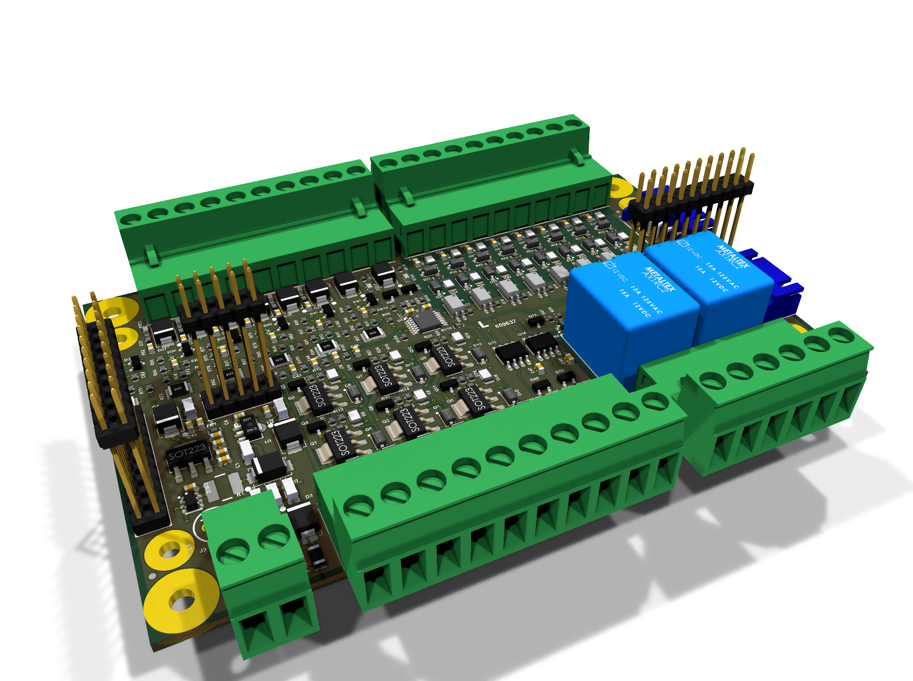
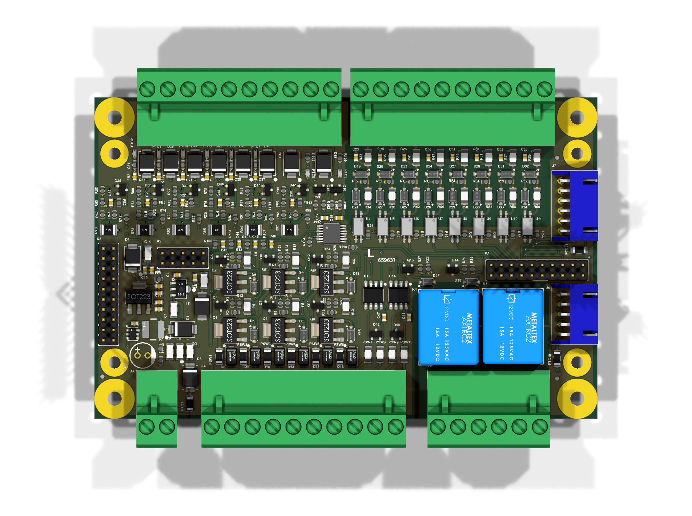
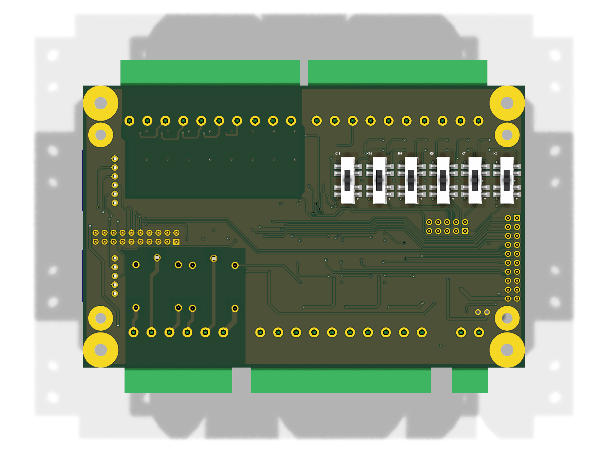
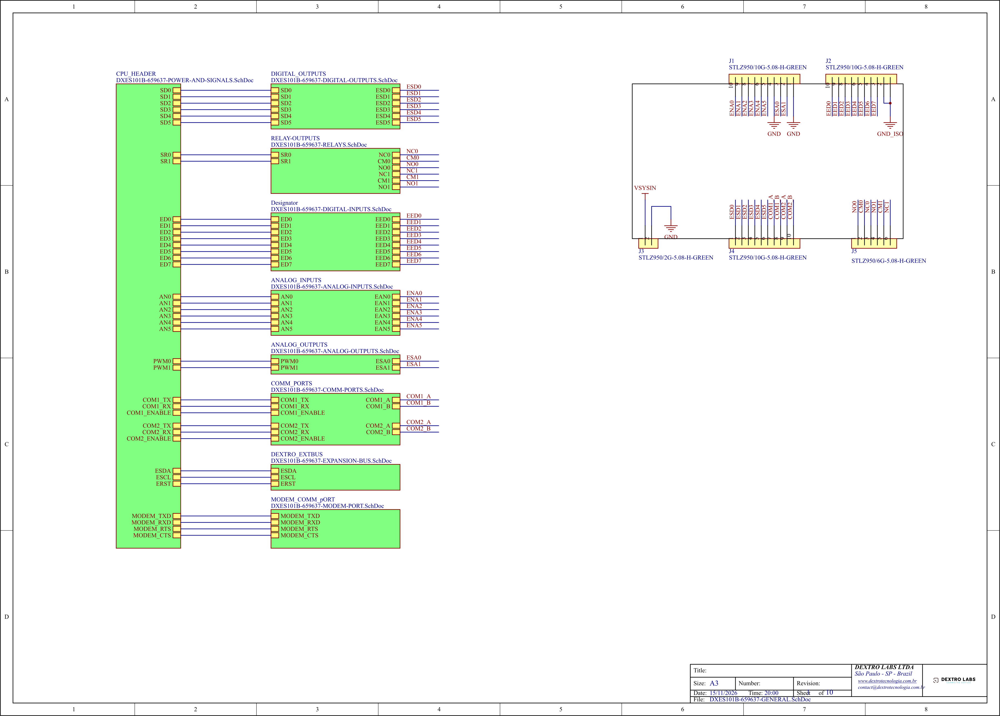
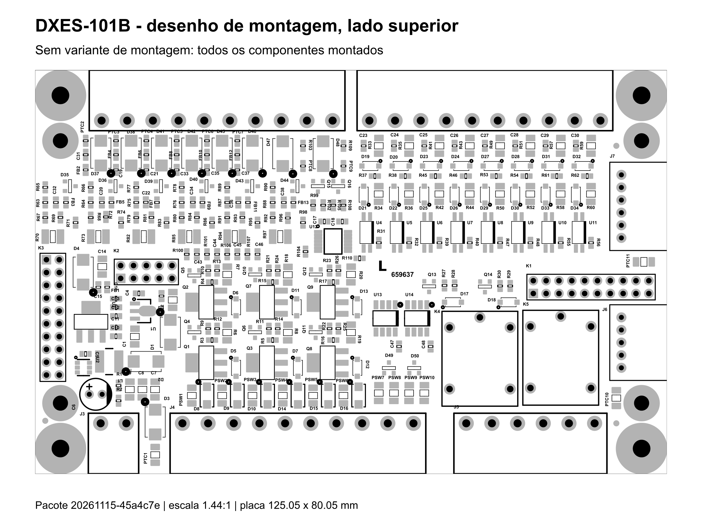
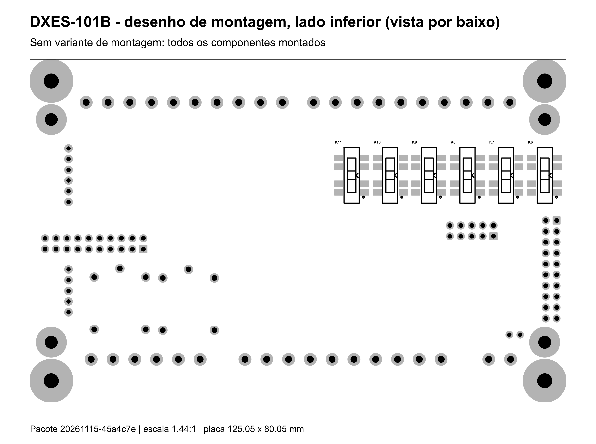

# DXES-101B — Placa-base de E/S industrial

Placa-base de entradas e saídas industriais do conjunto DXES. Recebe por cima, em três conectores de barra de pinos, a placa CPU **DXES-102** (ESP32-WROOM-32E, coprocessador de E/S STM32F030C6T6 e Ethernet W5500). A 101B não tem processador: ela alimenta a CPU com 5 V e condiciona os sinais de campo (bornes) para os níveis de 3,3 V da CPU. Projeto nº 659637 (prefixo dos arquivos: `DXES101B-659637`).

Este documento foi escrito a partir da netlist extraída dos esquemáticos e do dump do `DXES101B-659637.PcbDoc`. Tudo o que depende de datasheet e não pôde ser aberto está marcado como **não confirmado no datasheet** e repetido na [seção 10](#10-pendências-conhecidas).

<!-- fab:imagens -->


| Lado superior | Lado inferior |
|---|---|
|  |  |

> Imagens renderizadas pelo CI a partir do `.PcbDoc` (pacote `20261115-45a4c7e`).
<!-- /fab:imagens -->

## Índice

1. [Visão geral e arquivos do repositório](#1-visão-geral-e-arquivos-do-repositório)
2. [Características](#2-características)
3. [Descrição e funcionamento do circuito](#3-descrição-e-funcionamento-do-circuito)
4. [Entradas analógicas em detalhe](#4-entradas-analógicas-em-detalhe)
5. [Pinout para software](#5-pinout-para-software)
6. [Lista de materiais](#6-lista-de-materiais)
7. [Placa](#7-placa)
8. [Revisão do layout](#8-revisão-do-layout)
9. [Como testar a placa](#9-como-testar-a-placa)
10. [Pendências conhecidas](#10-pendências-conhecidas)

## 1. Visão geral e arquivos do repositório

O sinal de campo entra pelos bornes das bordas da placa, passa pelo bloco de condicionamento e chega a um dos três conectores da CPU (K1, K2, K3). A CPU DXES-102 monta virada sobre a 101B (face a face).

```
 J3 (alimentação) ── PTC1 ── VSYS ──┬─ buck U2 ── 5V ──┬─ K3.19/20 ──> CPU
                                    │                  └─ U3 ── 3,3V ── FB1 ── 3,3VA
                                    ├─ U1 ── 15V (saídas analógicas)
                                    └─ relés, saídas digitais, J6, J7

 J2 (8 entradas digitais) ── optoacopladores ──> K1.1–8
 J4 (6 saídas digitais)   <── P-MOSFET high-side <── K3.9–14
 J1 (6 entradas analóg.)  ── chave + divisor/shunt ──> K2.1–6
 J1 (2 saídas analóg.)    <── filtro PWM + LM324 ×3 <── K2.9–10
 J5 (2 relés)             <── BC846 <── K1.15–16
 J4 (2 × RS-485)          <─> MAX485 <─> K3.1–6
 J7 (modem RS-232)        <─> K1.9–12 (transceptor fica na CPU)
 J6 (barramento de expansão I²C) <─> K3.7–8, K1.14
```

### Arquivos

| Caminho | Conteúdo |
|---|---|
| `DXES-101B.PrjPcb` | Projeto Altium Designer |
| `DXES-101B.PrjPcbStructure` | Estrutura de folhas do projeto |
| `DXES101B-659637-GENERAL.SchDoc` | Folha GENERAL: bornes J1 a J5 |
| `DXES101B-659637-POWER-AND-SIGNALS.SchDoc` | Alimentação e conectores K1, K2, K3 da CPU |
| `DXES101B-659637-DIGITAL-INPUTS.SchDoc` | 8 entradas digitais isoladas |
| `DXES101B-659637-DIGITAL-OUTPUTS.SchDoc` | 6 saídas digitais high-side |
| `DXES101B-659637-ANALOG-INPUTS.SchDoc` | 6 entradas analógicas configuráveis |
| `DXES101B-659637-ANALOG-OUTPUTS.SchDoc` | 2 saídas analógicas |
| `DXES101B-659637-RELAYS.SchDoc` | 2 relés |
| `DXES101B-659637-COMM-PORTS.SchDoc` | 2 portas RS-485 |
| `DXES101B-659637-MODEM-PORT.SchDoc` | Conector do modem |
| `DXES101B-659637-EXPANSION-BUS.SchDoc` | Conector do barramento de expansão |
| `DXES101B-659637.PcbDoc` | Layout |
| `DXES101B-659637-GENERAL.PrjPcb` | Segundo arquivo de projeto, vazio: não lista nenhum documento (só caminhos de saída em branco). Não é outra placa e fica fora do pipeline |
| `tools/fab/` | Scripts do pipeline que gera a documentação de fabricação (kit de `marcosdxt/placas`) |
| `tools/fab/placas/DXES-101B.json` | Parâmetros da placa para o pipeline (processo, observações) |
| `.github/workflows/fabricacao.yml` | Workflow de CI que roda os scripts de `tools/fab` |
| `Project Outputs for DXES-101B/` | Relatório de DRC do Altium (`.drc` e `.html`) |
| `Project Logs for DXES-101B/` | Logs de ECO do Altium |
| `History/`, `__Previews/` | Gerados pelo Altium; ignorados pelo `.gitignore` |
| `.gitignore` | Exclusões de arquivos temporários do Altium |
| `README.md` | Este documento |

### Documentação de fabricação

<!-- fab:downloads -->
Gerados pelo CI (projeto sem variante de montagem: todos os componentes montados). Versão publicada: **`20261115-45a4c7e`**.

| Baixar | Conteúdo |
|---|---|
| [⬇ Pacote completo](https://github.com/marcosdxt/DXES-101B/releases/latest/download/DXES-101B-fab-latest.zip) | Tudo abaixo num zip, com instruções de fabricação |
| [⬇ Gerber + furação](https://github.com/marcosdxt/DXES-101B/releases/latest/download/DXES-101B-gerber-drill-latest.zip) | Zip para a fábrica de placas: Gerber RS-274X e NC Drill Excellon |
| [⬇ BOM (xlsx)](https://github.com/marcosdxt/DXES-101B/releases/latest/download/DXES-101B-bom-latest.xlsx) | Colunas do OutJob: Comment, Description, Designator, Footprint, Quantity, LCSC |
| [⬇ BOM (csv)](https://github.com/marcosdxt/DXES-101B/releases/latest/download/DXES-101B-bom-latest.csv) | A mesma BOM em CSV |
| [⬇ Pick and place](https://github.com/marcosdxt/DXES-101B/releases/latest/download/DXES-101B-pick-place-latest.csv) | Designator, Comment, Layer, Footprint, Center-X, Center-Y, Rotation, Description |
| [⬇ Desenho de montagem](https://github.com/marcosdxt/DXES-101B/releases/latest/download/DXES-101B-montagem-latest.pdf) | PDF do lado superior |
| [⬇ Desenho de montagem, lado inferior](https://github.com/marcosdxt/DXES-101B/releases/latest/download/DXES-101B-montagem-bottom-latest.pdf) | PDF do lado inferior, visto por baixo |
| [⬇ Esquema elétrico](https://github.com/marcosdxt/DXES-101B/releases/latest/download/DXES-101B-esquema-latest.pdf) | PDF vetorial, 10 folha(s) |
| [⬇ PDF 3D](https://github.com/marcosdxt/DXES-101B/releases/latest/download/DXES-101B-3D-latest.pdf) | Modelo 3D interativo (abrir no Adobe Reader) |
| [⬇ STEP](https://github.com/marcosdxt/DXES-101B/releases/latest/download/DXES-101B-latest.step) | Modelo 3D da placa montada |
| [⬇ DXF](https://github.com/marcosdxt/DXES-101B/releases/latest/download/DXES-101B-latest.dxf) | Contorno, pads, furos e serigrafia, em mm |
| [⬇ BOM JLCPCB](https://github.com/marcosdxt/DXES-101B/releases/latest/download/DXES-101B-jlcpcb-bom-latest.csv) | Comment, Designator, Footprint, LCSC Part # |
| [⬇ CPL JLCPCB](https://github.com/marcosdxt/DXES-101B/releases/latest/download/DXES-101B-jlcpcb-cpl-latest.csv) | Designator, Mid X, Mid Y, Layer, Rotation |

Os links apontam sempre para o último pacote publicado. Se o repositório for privado, eles exigem sessão do GitHub no navegador; por script, use `gh release download --pattern '*-latest.*'`. A prévia camada a camada dos Gerbers está em [`docs/PREVIA-GERBERS.md`](docs/PREVIA-GERBERS.md).

> **Avisos do último build:**
>
> - cobre calculado pelo KiCad, e nao pelo Altium, nas zonas que vieram sem preenchimento (planos internos): Layer 1 / 3,3V, Layer 1 / 3,3VA, Layer 1 / GND_ISO, Layer 1 / VSYS, Layer 2 / GND. Conferir a previa dessas camadas contra o Altium antes de fabricar
<!-- /fab:downloads -->

## 2. Características

Quantidades contadas na netlist. Valores elétricos de CIs só aparecem quando calculados a partir de componentes passivos do esquema.

| Item | Valor | Origem |
|---|---|---|
| Alimentação | 1 entrada CC em J3 (`VSYSIN`, GND). Tensão nominal não está escrita nos arquivos; o circuito indica 24 Vcc (regulador de 15 V a partir de `VSYS`, PTC de entrada com libref de 30 V) | J3, PTC1, U1 |
| Proteção de entrada | PTC `JK-nSMD050-30` (libref `PTC-FUSE-30V-500mA-1206`) em série e TVS `SMBJ33CA` para GND. Sem diodo de proteção contra inversão | PTC1, D3 |
| Trilhos internos | `VSYS` (entrada após o PTC), `5V` (buck RY9320AT6), `3,3V` (LM1117S-3.3), `3,3VA` (3,3 V após ferrite), `15V` (78L15) | U2, U3, FB1, U1 |
| Alimentação da CPU | 5 V em K3.19 e K3.20, GND em K3.17/18 e K2.7/8 | K3, K2 |
| Entradas digitais | 8, isoladas por optoacoplador EL3H7, comum `GND_ISO` separado do GND | U4–U11, J2 |
| Saídas digitais | 6, high-side (chaveiam `VSYS` para o borne) com P-MOSFET HT03P700S e PTC por canal | Q1–Q3, Q7–Q9, J4 |
| Entradas analógicas | 6, cada uma com chave de 3 posições: tensão (divisor 10/37), corrente (shunt 150 Ω) e pull-up de 10 kΩ para `3,3VA` (ver ressalva sobre a chave na seção 4.2) | K6–K11, J1 |
| Saídas analógicas | 2, em tensão, PWM filtrado com ganho 3 (0 a 9,9 V para PWM de 3,3 V) | U12, Q15, Q16, J1 |
| Relés | 2, um contato reversível cada (NO, CM, NC nos bornes) | K4, K5, J5 |
| RS-485 | 2 portas half-duplex (MAX485ESA), com PTC por linha e TVS SM712 | U13, U14, J4 |
| Porta de modem | 1 conector de 6 vias: `VSYS` protegido, TXD, RTS, RXD, CTS, GND. O transceptor RS-232 fica na CPU | J7, PTC11 |
| Barramento de expansão | 1 conector de 5 vias: `VSYS` protegido, GND, SDA, SCL, reset | J6, PTC10 |
| Conectores da CPU | 2 × 20 vias e 1 × 10 vias (`BPDDI-30MM-20`, `BPDDI-30MM-10`) | K1, K3, K2 |
| Placa | 125 × 80 mm, 4 camadas, 287 componentes (281 no lado superior, 6 chaves no lado inferior) | seção 7 |

## 3. Descrição e funcionamento do circuito

<!-- fab:esquema -->
PDF com as 10 folhas: [`docs/esquematico.pdf`](docs/esquematico.pdf)



A imagem acima é a primeira folha (`DXES101B-659637-GENERAL.SchDoc`); as demais estão no PDF.

Impresso pelo CI direto das 10 folhas do projeto (`DXES101B-659637-GENERAL.SchDoc`, `DXES101B-659637-POWER-AND-SIGNALS.SchDoc`, `DXES101B-659637-DIGITAL-OUTPUTS.SchDoc`, `DXES101B-659637-RELAYS.SchDoc`, `DXES101B-659637-DIGITAL-INPUTS.SchDoc`, `DXES101B-659637-ANALOG-INPUTS.SchDoc`, `DXES101B-659637-ANALOG-OUTPUTS.SchDoc`, `DXES101B-659637-COMM-PORTS.SchDoc`, `DXES101B-659637-EXPANSION-BUS.SchDoc`, `DXES101B-659637-MODEM-PORT.SchDoc`) (pacote `20261115-45a4c7e`).
<!-- /fab:esquema -->

Em cada bloco o caminho é descrito para um canal, com os designadores reais; a tabela ao final de cada bloco lista os componentes equivalentes dos outros canais.

### 3.1 POWER-AND-SIGNALS

**Entrada.** J3.1 (`VSYSIN`) passa pelo PTC1 e vira `VSYS`. D3 (SMBJ33CA) fica entre `VSYS` e GND. C6 (100 µF/35 V) e C1 (22 µF/25 V) desacoplam `VSYS`. Não há diodo em série nem em antiparalelo: a inversão de polaridade só é limitada pelo TVS bidirecional e pelo PTC.

**5 V.** U2 (RY9320AT6) é um conversor buck: IN (pino 5) e EN (pino 4) ligados direto em `VSYS`, SW (pino 6) no indutor L1 (10 µH), capacitor de bootstrap C5 (100 nF) entre BS (pino 1) e SW. A saída `5V` tem C7, C8, C9 (22 µF), C10 (10 µF), C11 (100 nF) e o TVS D2 (SMBJ5.0A). O divisor de realimentação é R1 (69,8 kΩ, de `5V` a FB) e R2 (9,53 kΩ, de FB a GND):

```
Vout = Vfb × (1 + R1/R2) = Vfb × (1 + 69,8/9,53) = Vfb × 8,324
```

Se a referência do RY9320AT6 for 0,6 V, Vout = 0,6 × 8,324 = 4,99 V. A tensão de referência, a faixa de entrada e a corrente máxima do RY9320AT6 **não foram confirmadas no datasheet** (o PDF não abriu).

**3,3 V.** U3 (LM1117S-3.3) regula `3,3V` a partir de `5V`, com C12 (10 µF), C13 (100 nF) e D4 (SMBJ5.0A). O ferrite FB1 (BLM18PG121SN1D) separa `3,3VA`, desacoplado por C14 (22 µF), C15 (10 µF) e C16 (100 nF). O `3,3V` desta placa alimenta só os pull-ups das entradas digitais (R31, R32, R39, R40, R47, R48, R55, R56); o `3,3VA` alimenta os pull-ups e os grampos das entradas analógicas. Nenhum dos dois vai para a CPU: a DXES-102 recebe apenas `5V` e gera os próprios 3,3 V.

**15 V.** U1 (78L15) regula `15V` a partir de `VSYS`, com C2 (22 µF), C3, C4 (10 µF) e D1 (SMBJ15CA). Só as saídas analógicas usam esse trilho. Para regular, `VSYS` precisa ficar acima de 15 V mais a queda mínima do 78L15 (não confirmada no datasheet).

**Conectores da CPU.** K1 (20 vias), K2 (10 vias) e K3 (20 vias). Pinagem completa na seção 5.

### 3.2 DIGITAL-INPUTS

Canal 0: J2.10 (`EED0`) → R33 (2 kΩ, 1206) → nó com C23 (100 nF), R37 (10 kΩ) e D19 (1N4148, catodo no nó), todos para `GND_ISO` → R34 (2 kΩ, 1206) → anodo do LED de U4 (EL3H7). O catodo do LED vai ao catodo de D21 (BZT52C5V1), cujo anodo está em `GND_ISO`. Do lado da CPU, o emissor de U4 está em GND e o coletor é a net `ED0`, com pull-up R31 (2 kΩ) para `3,3V`, e segue para K1.1.

Funcionamento:

- A entrada é do tipo que recebe tensão positiva em relação a `GND_ISO` (J2.1 e J2.2). `GND_ISO` não tem ligação com GND em nenhum ponto da netlist: o grupo das 8 entradas é isolado do resto da placa, com um comum único para as 8.
- O zener em série com o LED cria um limiar. O LED só conduz quando o nó passa de Vz + Vf. Com o divisor R33/R37: `Vin_limiar = (Vz + Vf) × (R33 + R37)/R37 = (5,1 + Vf) × 1,2`. Supondo Vf ≈ 1,2 V (valor não confirmado no datasheet do EL3H7), o limiar fica em ≈ 7,6 V.
- Corrente no LED pelo equivalente de Thévenin do divisor: `Vth = Vin × 10/12`, `Rth = 2k ∥ 10k = 1,667 kΩ`, `I_LED = (Vth − Vz − Vf)/(Rth + R34)`. Em 24 V: (20 − 5,1 − 1,2)/3667 Ω = 3,7 mA. Em 12 V: (10 − 6,3)/3667 Ω = 1,0 mA.
- Para saturar o fototransistor contra o pull-up de 2 kΩ são necessários 3,3 V/2 kΩ = 1,65 mA de coletor. Em 24 V isso pede CTR ≥ 44 %; em 12 V pede CTR ≥ 164 %. A faixa de CTR do EL3H7(C) não foi confirmada no datasheet; em 12 V o nível baixo pode não ser garantido.
- D19 limita a tensão reversa sobre o conjunto se a entrada for ligada invertida. C23 com Rth dá constante de tempo de 1,667 kΩ × 100 nF = 0,17 ms.
- **O optoacoplador inverte**: entrada energizada → `EDn` em nível baixo; entrada aberta → `EDn` em 3,3 V.

| Canal | Borne | Resistores de entrada | Nó (C, D, R) | Zener | Opto | Pull-up | Conector |
|---|---|---|---|---|---|---|---|
| ED0 | J2.10 | R33, R34 | C23, D19, R37 | D21 | U4 | R31 | K1.1 |
| ED1 | J2.9 | R35, R36 | C24, D20, R38 | D22 | U5 | R32 | K1.2 |
| ED2 | J2.8 | R41, R42 | C25, D23, R45 | D25 | U6 | R39 | K1.3 |
| ED3 | J2.7 | R43, R44 | C26, D24, R46 | D26 | U7 | R40 | K1.4 |
| ED4 | J2.6 | R49, R50 | C27, D27, R53 | D29 | U8 | R47 | K1.5 |
| ED5 | J2.5 | R51, R52 | C28, D28, R54 | D30 | U9 | R48 | K1.6 |
| ED6 | J2.4 | R57, R58 | C29, D31, R61 | D33 | U10 | R55 | K1.7 |
| ED7 | J2.3 | R59, R60 | C30, D32, R62 | D34 | U11 | R56 | K1.8 |

### 3.3 DIGITAL-OUTPUTS

Canal 0: K3.9 (`SD0`) → R9 (10 kΩ) → base de Q4 (BC846), com R12 (10 kΩ) da base para GND. Emissor em GND. Coletor → R6 (2 kΩ, 1206) → gate de Q1 (HT03P700S). Entre gate e `VSYS` ficam R3 (100 kΩ) e D5 (BZT52C5V1, catodo em `VSYS`). A fonte de Q1 está em `VSYS`; o dreno vai a D8 (1N4007-M7, anodo em GND, catodo no dreno), passa pelo PTC PSW1 (ASMD1206H020) e sai em J4.1 (`ESD0`).

Funcionamento:

- Saída high-side: quando ligada, o borne recebe `VSYS`. A carga é ligada entre o borne e GND. J4 não tem pino de GND; o retorno da carga usa J3.2 ou os pinos de GND de J1.
- `SD0` em nível alto satura Q4, que puxa o gate através de R6. D5 limita a tensão gate-fonte a 5,1 V e R3 desliga o MOSFET quando Q4 corta. **Nível alto no MCU = saída ligada.** Com a CPU ausente ou em reset, R12 mantém a saída desligada.
- D8 é o diodo de roda livre para cargas indutivas. PSW1 limita a corrente em curto (corrente de retenção do ASMD1206H020 não confirmada no datasheet).
- Corrente em R6 com a saída ligada: `I = (VSYS − Vz − Vce)/R6`. Em 24 V: (24 − 5,1 − 0,2)/2 kΩ = 9,4 mA, e `P = I² × R6` = 175 mW (o libref indica 250 mW). O limite de 250 mW é atingido com I = 11,2 mA, isto é, `VSYS` ≈ 27,7 V.
- Corrente de base de Q4, supondo 3,3 V no pino do MCU e Vbe = 0,7 V: (3,3 − 0,7)/10 kΩ − 0,7/10 kΩ = 0,19 mA. Para conduzir 9,4 mA o transistor precisa de ganho ≥ 49 (ganho do BC846B não confirmado no datasheet).
- O desligamento depende de R3 (100 kΩ) descarregar o gate; o circuito não foi pensado para PWM rápido.

| Canal | Conector | Base (série, terra) | NPN | R de gate | Gate-fonte (R, zener) | MOSFET | Roda livre | PTC | Borne |
|---|---|---|---|---|---|---|---|---|---|
| SD0 | K3.9 | R9, R12 | Q4 | R6 | R3, D5 | Q1 | D8 | PSW1 | J4.1 |
| SD1 | K3.10 | R10, R13 | Q5 | R7 | R4, D6 | Q2 | D9 | PSW2 | J4.2 |
| SD2 | K3.11 | R11, R14 | Q6 | R8 | R5, D7 | Q3 | D10 | PSW3 | J4.3 |
| SD3 | K3.12 | R21, R24 | Q10 | R18 | R15, D11 | Q7 | D14 | PSW4 | J4.4 |
| SD4 | K3.13 | R22, R25 | Q11 | R19 | R16, D12 | Q8 | D15 | PSW5 | J4.5 |
| SD5 | K3.14 | R23, R26 | Q12 | R20 | R17, D13 | Q9 | D16 | PSW6 | J4.6 |

### 3.4 ANALOG-INPUTS

Canal 0: J1.10 (`EAN0`) → PTC2 → nó com D37 (SMBJ33CA para GND) → ferrite FB2 → nó com C31 (100 nF para GND) → pino 4 da chave K6. A chave liga esse sinal a uma de três redes resistivas (150 Ω, 27 kΩ/10 kΩ ou pull-up de 10 kΩ) e devolve o resultado pelo pino 5 → nó com D35 (BAT54S entre GND e `3,3VA`) → ferrite FB3 → C32 (100 nF para GND) → `AN0` → K2.1.

O funcionamento completo, com as contas, está na [seção 4](#4-entradas-analógicas-em-detalhe).

| Canal | Borne | PTC | TVS | Ferrites | Capacitores | Chave | Shunt | Divisor (27k, 10k) | Série do shunt | Pull-up, série | BAT54S | Conector |
|---|---|---|---|---|---|---|---|---|---|---|---|---|
| AN0 | J1.10 | PTC2 | D37 | FB2, FB3 | C31, C32 | K6 | R70 | R67, R69 | R71 | R63, R65 | D35 | K2.1 |
| AN1 | J1.9 | PTC3 | D38 | FB4, FB5 | C19, C20 | K7 | R73 | R68, R72 | R74 | R64, R66 | D36 | K2.2 |
| AN2 | J1.8 | PTC4 | D41 | FB6, FB7 | C21, C22 | K8 | R82 | R79, R81 | R83 | R75, R77 | D39 | K2.3 |
| AN3 | J1.7 | PTC5 | D42 | FB8, FB9 | C33, C34 | K9 | R85 | R80, R84 | R86 | R76, R78 | D40 | K2.4 |
| AN4 | J1.6 | PTC6 | D45 | FB10, FB11 | C35, C36 | K10 | R94 | R91, R93 | R95 | R87, R89 | D43 | K2.5 |
| AN5 | J1.5 | PTC7 | D46 | FB12, FB13 | C37, C38 | K11 | R97 | R92, R96 | R98 | R88, R90 | D44 | K2.6 |

### 3.5 ANALOG-OUTPUTS

Canal 0: K2.10 (`PWM0`) → R100 (10 kΩ) → C43 (100 nF) → R101 (10 kΩ) → C44 → pino 3 (+) de U12 (LM324PWR). O primeiro amplificador é seguidor (pinos 1 e 2 unidos) e entrega o nível filtrado ao pino 5 (+) do segundo. A saída do segundo (pino 7) passa por R102 (100 Ω) e vai à base de Q15 (BC846). O coletor de Q15 liga a `15V` por R99 (100 Ω); o emissor passa pelo PTC8 e sai em J1.3 (`ESA0`), com D47 (SMBJ15CA) para GND. A realimentação é tomada no próprio borne: R103 (2 kΩ) de `ESA0` ao pino 6 (−) e R104 (1 kΩ) do pino 6 a GND.

Funcionamento:

- O MCU gera PWM; o filtro RC de dois estágios extrai o valor médio; o LM324 com Q15 como seguidor de emissor dentro da malha multiplica por 3:

```
Vsaída = (1 + R103/R104) × D × V_PWM = 3 × D × 3,3 V     (D = razão cíclica, 0 a 1)
D = 100 %  →  9,9 V
```

- Polos do filtro: `f1 = 1/(2π × R100 × C43)` = 1/(2π × 10 kΩ × 100 nF) = 159 Hz. O segundo depende de C44: o libref é `CAP-22nF/50V`, mas o campo Comment diz `220F/50V`. Com 22 nF, `f2` = 1/(2π × 10 kΩ × 22 nF) = 723 Hz. Como os dois estágios usam o mesmo resistor, o segundo carrega o primeiro e os polos reais se afastam um pouco desses valores.
- Como a realimentação sai de `ESA0`, depois do PTC8, a queda no PTC é compensada pela malha.
- A saída só fornece corrente. Para baixo, o único caminho é R103 + R104 = 3 kΩ para GND.
- O PTC8 tem libref `PTC-FUSE-60V-10mA-0603`: se a retenção for mesmo 10 mA, a carga mínima em 10 V é 10 V/10 mA = 1 kΩ (não confirmado no datasheet).
- Para chegar a 9,9 V o amplificador precisa colocar ≈ 10,6 V na base de Q15. A excursão de saída do LM324 com 15 V não foi confirmada no datasheet.

| Canal | Conector | Filtro | Amplificadores de U12 | Base | Transistor | Coletor | Realimentação | PTC | TVS | Borne |
|---|---|---|---|---|---|---|---|---|---|---|
| Saída 0 | K2.10 (`PWM0`) | R100, C43, R101, C44 | seguidor: pinos 1-2-3; ganho: pinos 5-6-7 | R102 | Q15 | R99 | R103, R104 | PTC8 | D47 | J1.3 (`ESA0`) |
| Saída 1 | K2.9 (`PWM1`) | R106, C45, R107, C46 | seguidor: pinos 12-13-14; ganho: pinos 8-9-10 | R108 | Q16 | R105 | R109, R110 | PTC9 | D48 | J1.2 (`ESA1`) |

C17 (10 µF) e C18 (100 nF) desacoplam o `15V` junto a U12.

### 3.6 RELAYS

Canal 0: K1.15 (`SR0`) → R27 (1 kΩ) → base de Q13 (BC846), com R28 (10 kΩ) da base para GND. Emissor em GND. O coletor vai ao pino 2 da bobina de K4 (AX1RC3); o pino 1 da bobina está em `VSYS`. D17 (1N4148) fica em antiparalelo com a bobina (catodo em `VSYS`). Contatos: K4.3 → J5.2 (`CM0`), K4.4 → J5.1 (`NO0`), K4.5 → J5.3 (`NC0`).

- **Nível alto no MCU = relé energizado** (CM fecha com NO). Com a CPU ausente, R28 mantém o relé solto (CM com NC).
- A bobina recebe `VSYS` inteiro: a tensão de bobina do AX1RC3 precisa ser igual à tensão de alimentação da placa (não confirmado no datasheet).
- Corrente de base, supondo 3,3 V e Vbe = 0,7 V: (3,3 − 0,7)/1 kΩ − 0,7/10 kΩ = 2,5 mA, fornecidos pelo pino do STM32 (ver pendência sobre PC13/PC14).
- Os contatos não têm snubber nem varistor na placa.

| Relé | Conector | Base (série, terra) | NPN | Diodo | Relé | Bornes |
|---|---|---|---|---|---|---|
| 0 | K1.15 (`SR0`) | R27, R28 | Q13 | D17 | K4 | J5.1 NO, J5.2 CM, J5.3 NC |
| 1 | K1.16 (`SR1`) | R29, R30 | Q14 | D18 | K5 | J5.4 NO, J5.5 CM, J5.6 NC |

### 3.7 COMM-PORTS

Porta 1: U13 (MAX485ESA), alimentado em `5V` com C47 (100 nF). DI (pino 4) recebe `COM1_TX` de K3.1; RO (pino 1) entrega `COM1_RX` em K3.2; DE (pino 3) e /RE (pino 2) estão unidos em `COM1_ENABLE`, de K3.3. A linha A (pino 6) passa pelo PTC PSW7 (SMD1206B010TF) e sai em J4.7; a linha B (pino 7) passa por PSW8 e sai em J4.8. D49 (SM712) protege A e B contra GND, do lado do transceptor.

- Half-duplex: **`COMx_ENABLE` alto = transmite; baixo = recebe.**
- Não há resistor de terminação nem de polarização (fail-safe) na placa. J4 também não tem pino de GND para o cabo RS-485.
- U13 e U14 são alimentados em 5 V, então RO pode chegar a esse nível. Na CPU, `COM1_RX` passa por 1 kΩ e por um grampo BAT54S antes do ESP32; `COM2_RX` chega direto ao pino PA10 do STM32 (ver pendências).

| Porta | CI | TX (DI) | RX (RO) | Habilitação | Linha A | Linha B | TVS | Desacoplamento |
|---|---|---|---|---|---|---|---|---|
| COM1 | U13 | K3.1 | K3.2 | K3.3 | PSW7 → J4.7 | PSW8 → J4.8 | D49 | C47 |
| COM2 | U14 | K3.5 | K3.6 | K3.4 | PSW9 → J4.9 | PSW10 → J4.10 | D50 | C48 |

### 3.8 MODEM-PORT

J7 (6 vias) leva ao modem externo os sinais seriais que vêm de K1.9 a K1.12 e a alimentação `VSYS` através do PTC11 (`JK-nSMD050-30`). Não há nenhum componente ativo nem proteção nas linhas de dados nesta placa: o transceptor (MAX3232, U4 da DXES-102) fica na CPU, e os sinais em J7 são os do lado de linha desse transceptor.

| J7 | Sinal | Origem |
|---|---|---|
| 1 | `VSYS` via PTC11 | alimentação do modem |
| 2 | `MODEM_TXD` | K1.10 (saída da CPU) |
| 3 | `MODEM_RTS` | K1.11 (saída da CPU) |
| 4 | `MODEM_RXD` | K1.9 (entrada da CPU) |
| 5 | `MODEM_CTS` | K1.12 (entrada da CPU) |
| 6 | GND | — |

O símbolo de J7 tem libref `PEMN1-06` (6 pinos) e Comment `PEMN1-04`.

### 3.9 EXPANSION-BUS

J6 (5 vias) é o barramento de expansão: `VSYS` através do PTC10, GND, `ESDA` (K3.7), `ESCL` (K3.8) e `ERST` (K1.14). Na CPU, `ESDA`/`ESCL` são o lado externo de um repetidor I²C (PCA9515) com pull-ups de 2 kΩ para 3,3 V e TVS; `ERST` é o coletor aberto de um BC846. Na 101B não há pull-up em `ERST`: o módulo de expansão precisa fornecer o seu.

### 3.10 GENERAL

A folha GENERAL contém apenas os bornes de campo: J1 (10 vias, analógicas), J2 (10 vias, entradas digitais), J3 (2 vias, alimentação), J4 (10 vias, saídas digitais e RS-485) e J5 (6 vias, relés), todos da série STLZ950 passo 5,08 mm. A tabela de sinais está na seção 5.5.

## 4. Entradas analógicas em detalhe

### 4.1 Rede de cada canal (designadores do canal 0)

```
J1.10 ─ PTC2 ─┬─ FB2 ─┬──────── K6.4                 K6.5 ──┬─ FB3 ─┬─ AN0 (K2.1)
              │       │                                     │       │
             D37     C31                                   D35     C32
           SMBJ33CA  100n                                 BAT54S   100n
              │       │                               (GND, 3,3VA)  │
             GND     GND                                           GND

 K6.1 ──┬── R70 150 Ω ── GND
        └── R71 10 kΩ ── K6.8

 K6.2 ── R67 27 kΩ ──┬── K6.7
                     └── R69 10 kΩ ── GND

 K6.3 ──┬── R63 10 kΩ ── 3,3VA
        └── R65 10 kΩ ── K6.6
```

Isso é o que a netlist garante: o sinal de entrada chega ao pino 4, o sinal para o ADC sai do pino 5, e os pinos 1/8, 2/7 e 3/6 formam três pares, cada par com uma rede resistiva diferente entre eles.

### 4.2 O que cada posição seleciona

**Dedução.** A netlist só faz sentido elétrico se a chave ligar o pino 4 a um dos pinos 1, 2 ou 3 e, ao mesmo tempo, o pino 5 ao pino correspondente do outro polo (8, 7 ou 6). É assim que o esquema foi desenhado, e as três funções abaixo são deduzidas dessa leitura. A netlist não diz qual posição mecânica do cursor corresponde a cada par, então as posições são identificadas aqui pelos pinos que elas unem.

| Posição (pinos unidos) | Função | Rede no caminho | Relação | Faixa para ADC de 3,3 V |
|---|---|---|---|---|
| 4–2 e 5–7 | Tensão | R67 (27 kΩ) em série, R69 (10 kΩ) para GND | V_ADC = Vin × 10/37 | 0 a 12,21 V (10 V → 2,70 V) |
| 4–1 e 5–8 | Corrente (4–20 mA) | R70 (150 Ω) para GND, R71 (10 kΩ) em série com o ADC | V_ADC = I × 150 Ω | 0 a 22 mA (4 mA → 0,60 V; 20 mA → 3,00 V) |
| 4–3 e 5–6 | Pull-up (sensor resistivo ou contato seco) | R63 (10 kΩ) para `3,3VA`, R65 (10 kΩ) em série com o ADC | V_ADC = 3,3 × Rs/(Rs + 10 kΩ) | Rs de 0 a ∞ (aberto → 3,3 V) |

**Conferência contra o datasheet (15/11/2026): o esquema está ligado no terminal errado.** O "CIRCUIT DIAGRAM" do datasheet da SHOU HAN ([`docs/datasheets/MST-23D18G2-BD.pdf`](docs/datasheets/MST-23D18G2-BD.pdf), desenho de 13/07/2020, pág. 1) mostra, em cada polo, quatro contatos em linha: um curto, um **longo**, e mais dois curtos. As três posições (B, A e C) ligam sempre o contato **longo** a um dos outros três. O comum de cada polo é, portanto, o **segundo terminal da fileira**, e não o da ponta.

O símbolo que a LCSC/EasyEDA publica para a peça (C7507443) confirma a leitura e dá a numeração: fileira 1-2-3-4 de um lado e 8-7-6-5 do outro, com o **pino 2 comum de 1, 3 e 4** e o **pino 7 comum de 8, 6 e 5**. É a mesma numeração do footprint `SW-SMD_SHOU_MST23D18G2` usado na placa (pads 1, 2, 3, 4 em x = −4, −2, +2, +4 mm; 8, 7, 6, 5 em frente). O símbolo da EasyEDA é fonte secundária; o diagrama do datasheet não numera os terminais.

O esquema da DXES-101B usa os pinos **4 e 5** (as pontas) como comuns. Com a chave real, o resultado em cada posição é:

| Posição da chave (pinos unidos) | O que acontece no circuito atual |
|---|---|
| 2–4 e 7–5 | Entrada (pino 4) → R67 (27 kΩ) → nó de R69 (10 kΩ para GND) → saída (pino 5). **Funciona como modo tensão**, V_ADC = Vin × 10/37 |
| 2–3 e 7–6 | Entrada e saída ficam abertas. O pino do ADC flutua (só o grampo D35 e C32). `3,3VA` alimenta R63 → R65 ∥ R67 → R69 → GND sem função |
| 2–1 e 7–8 | Entrada e saída ficam abertas. O pino do ADC flutua. R67 ∥ R71 ficam entre o shunt e R69, sem função |

Ou seja: **só o modo tensão funciona; os modos corrente e pull-up não existem na placa como está**, e em duas das três posições o ADC lê um valor indefinido.

**Correção no esquema** (vale para K6 a K11): levar a entrada ao pino 2 e a saída para o ADC ao pino 7, e distribuir as três redes pelos pares 1/8, 3/6 e 4/5. Por exemplo:

| Par | Rede | Modo |
|---|---|---|
| 1 e 8 | R70 (150 Ω) do pino 1 para GND; R71 (10 kΩ) do pino 1 ao pino 8 | Corrente |
| 3 e 6 | R67 (27 kΩ) do pino 3 ao pino 6; R69 (10 kΩ) do pino 6 para GND | Tensão |
| 4 e 5 | R63 (10 kΩ) do pino 4 ao `3,3VA`; R65 (10 kΩ) do pino 4 ao pino 5 | Pull-up |

Antes de refazer o layout, vale um teste de continuidade com uma peça na mão (seção 9.5), porque o datasheet não marca o pino 1 no corpo e a peça não é simétrica: girada 180°, o comum cai nos pads 3 e 6.

O restante desta seção descreve as três funções como o esquema as pretende.


### 4.3 Modo tensão

```
k = R69/(R67 + R69) = 10/(27 + 10) = 0,2703
V_ADC = Vin × k
Vin de fundo de escala = 3,3 V/k = 3,3 × 3,7 = 12,21 V
Vin = 10 V  →  V_ADC = 2,703 V  (81,9 % do fundo de escala)
Impedância de entrada = R67 + R69 = 37 kΩ
```

- Erro do divisor com resistores de 1 %: `δk/k = [R67/(R67 + R69)] × (δR69 − δR67)` = 0,73 × 2 % = ± 1,46 % no pior caso. Convém calibrar por canal no firmware.
- Resolução, se a conversão for de 12 bits (a confirmar no firmware): 12,21 V/4096 = 2,98 mV por contagem.
- Impedância vista pelo ADC: R67 ∥ R69 = 7,30 kΩ. Com C32: `τ = 7,30 kΩ × 100 nF` = 0,73 ms, `fc = 1/(2πτ)` = 218 Hz.
- Sobretensão: acima de 12,2 V o BAT54S começa a desviar corrente para `3,3VA`. Em 33 V, com o nó grampeado em ≈ 3,6 V: corrente em R67 = (33 − 3,6)/27 kΩ = 1,09 mA (32 mW em R67); R69 absorve 0,36 mA e o diodo conduz ≈ 0,73 mA para `3,3VA`.

### 4.4 Modo corrente

```
V_ADC = I × R70 = I × 150 Ω
 4 mA → 0,600 V       20 mA → 3,000 V       fundo de escala: 3,3 V/150 Ω = 22,0 mA
Potência em R70 a 20 mA = I² × R = 0,02² × 150 = 60 mW   (libref: 125 mW)
Corrente que leva R70 a 125 mW = √(0,125/150) = 28,9 mA
```

- O transmissor "enxerga" 3,0 V a 20 mA sobre o shunt, mais a queda no PTC2 e no ferrite FB2 (resistência do PTC não confirmada no datasheet). Essa queda adicional não altera a medição, porque o ADC lê só a tensão sobre R70.
- Laço abaixo de 4 mA (fio partido) aparece como leitura abaixo de 0,6 V.
- Resolução com 12 bits: 22 mA/4096 = 5,4 µA por contagem.
- Filtro: `τ = (R70 + R71) × C32` = 10,15 kΩ × 100 nF = 1,0 ms, `fc` = 157 Hz.
- Sobretensão: se 24 V forem aplicados direto à entrada neste modo, R70 recebe 24²/150 = 3,8 W até o PTC2 atuar. A proteção de R70 depende do tempo de atuação do PTC (não confirmado no datasheet).
- O libref do PTC2 é `PTC-FUSE-60V-10mA-0603`. Se 10 mA for a corrente de retenção, um laço em 20 mA trabalha acima dela (ver pendência 4).

### 4.5 Modo pull-up

```
V_ADC = 3,3VA × Rs/(Rs + R63)        Rs = R63 × V_ADC/(3,3 − V_ADC)        (R63 = 10 kΩ)
Rs = ∞ (aberto) → 3,30 V      Rs = 10 kΩ → 1,65 V      Rs = 0 (contato fechado) → 0 V
Corrente máxima no sensor = 3,3 V/10 kΩ = 0,33 mA
```

- Serve para sensores resistivos ligados entre o borne e GND (NTC, potenciômetro como reostato) e para contato seco.
- R65 fica em série com o ADC e não entra na conta em regime, porque a entrada do ADC não drena corrente contínua.
- Filtro: `τ = (R65 + R63 ∥ Rs) × C32`. Com o borne aberto: 20 kΩ × 100 nF = 2,0 ms (80 Hz). Com Rs = 10 kΩ: 15 kΩ × 100 nF = 1,5 ms (106 Hz).
- A medida é proporcional ao `3,3VA` da 101B (LM1117 + ferrite), enquanto o ADC do STM32 usa como referência o `3,3VA` da DXES-102, gerado por outro regulador. A diferença entre os dois trilhos entra direto como erro neste modo (ver pendência 13).
- Sobretensão: uma tensão externa aplicada neste modo alimenta `3,3VA` por R63. Em 33 V: (33 − 3,3)/10 kΩ = 3,0 mA e 88 mW em R63 (libref: 100 mW).

### 4.6 Proteção

A cadeia é a mesma nos três modos, do borne para o ADC:

1. **PTC2** (`BSMD0603-001-60V`) em série: limita a corrente sustentada em caso de erro de ligação.
2. **D37** (SMBJ33CA) para GND, depois do PTC: grampeia surtos. O sufixo CA indica dispositivo bidirecional; tensões de ruptura e de grampeamento não confirmadas no datasheet. O PTC antes do TVS limita a corrente que o TVS precisa absorver em sobretensão contínua.
3. **FB2** (BLM18PG121SN1D) e **C31** (100 nF): filtro de alta frequência na entrada, antes da chave.
4. **Resistor série do modo selecionado** (R67 de 27 kΩ, R71 de 10 kΩ ou R65 de 10 kΩ): limita a corrente que chega ao grampo. Em qualquer posição existe pelo menos 10 kΩ entre o borne e o pino do ADC.
5. **D35** (BAT54S): pela ligação (pino 1 em GND, pino 2 em `3,3VA`, pino 3 no sinal), é usado como grampo para os dois trilhos, mantendo o sinal entre aproximadamente −0,3 V e `3,3VA` + 0,3 V. Configuração interna e queda direta não confirmadas no datasheet.
6. **FB3** e **C32** (100 nF): filtro final junto ao conector da CPU. C32 também serve de reservatório de carga para a amostragem do ADC.

A corrente desviada pelo BAT54S entra no trilho `3,3VA`. Com as 6 entradas em sobretensão ao mesmo tempo em modo pull-up (3,0 mA cada), são até 18 mA injetados; o trilho só não sobe se o consumo em `3,3VA`/`3,3V` for maior que isso, e D4 (SMBJ5.0A em `3,3V`) é o último limite.

## 5. Pinout para software

### 5.1 Como a CPU encaixa

| DXES-102 | DXES-101B | Vias |
|---|---|---|
| K2 | K1 | 20 |
| K1 | K2 | 10 |
| K3 | K3 | 20 |

A 102 monta virada, face a face, espelhada em X. Por isso o pino ímpar de um lado encontra o par vizinho do outro: 1↔2, 3↔4, 5↔6 e assim por diante. Todas as tabelas abaixo foram obtidas cruzando as duas netlists por essa regra; os nomes de net coincidem nos dois lados em todos os pinos, exceto em K2.9/K2.10 (ver nota da seção 5.3).

Nas tabelas, "sentido" é visto pelo MCU. U9 é o STM32F030C6T6 e U2 é o ESP32-WROOM-32E, ambos na DXES-102. O ESP32 fala com o STM32 por I²C dentro da 102 (IO21/IO22 ↔ PB7/PB6); as E/S ligadas ao STM32 são acessadas por esse caminho.

### 5.2 K1 da 101B (K2 da 102)

| K1 (101B) | Net na 101B | Função | K2 (102) | Pino do MCU | Sentido | Nível ativo |
|---|---|---|---|---|---|---|
| 1 | `ED0` | Entrada digital 0 (J2.10) | 2 | U9.45 PB8 | entrada | baixo = entrada energizada |
| 2 | `ED1` | Entrada digital 1 (J2.9) | 1 | U9.46 PB9 | entrada | baixo = entrada energizada |
| 3 | `ED2` | Entrada digital 2 (J2.8) | 4 | U9.20 PB2 | entrada | baixo = entrada energizada |
| 4 | `ED3` | Entrada digital 3 (J2.7) | 3 | U9.21 PB10 | entrada | baixo = entrada energizada |
| 5 | `ED4` | Entrada digital 4 (J2.6) | 6 | U9.39 PB3 | entrada | baixo = entrada energizada |
| 6 | `ED5` | Entrada digital 5 (J2.5) | 5 | U9.22 PB11 | entrada | baixo = entrada energizada |
| 7 | `ED6` | Entrada digital 6 (J2.4) | 8 | U9.25 PB12 | entrada | baixo = entrada energizada |
| 8 | `ED7` | Entrada digital 7 (J2.3) | 7 | U9.26 PB13 | entrada | baixo = entrada energizada |
| 9 | `MODEM_RXD` | RXD do modem (J7.4) | 10 | U2.7 IO35, via MAX3232 (RIN1 → ROUT1) | entrada | nível RS-232 no conector |
| 10 | `MODEM_TXD` | TXD para o modem (J7.2) | 9 | U2.9 IO33, via MAX3232 (DIN1 → DOUT1) | saída | nível RS-232 no conector |
| 11 | `MODEM_RTS` | RTS para o modem (J7.3) | 12 | U2.16 IO13, via MAX3232 (DIN2 → DOUT2) | saída | nível RS-232 no conector |
| 12 | `MODEM_CTS` | CTS do modem (J7.5) | 11 | U2.23 IO15, via MAX3232 (RIN2 → ROUT2) | entrada | nível RS-232 no conector |
| 13 | — | Não conectado | 14 | — | — | — |
| 14 | `ERST` | Reset do barramento de expansão (J6.5) | 13 | U2.14 IO12, via BC846 em coletor aberto | saída | IO12 alto = `ERST` em nível baixo |
| 15 | `SR0` | Relé 0 (K4) | 16 | U9.2 PC13 | saída | alto = relé energizado |
| 16 | `SR1` | Relé 1 (K5) | 15 | U9.3 PC14 | saída | alto = relé energizado |
| 17–20 | — | Não conectados | 18, 17, 20, 19 | — | — | — |

A polaridade lógica das linhas do modem depende do MAX3232 (não confirmada no datasheet).

### 5.3 K2 da 101B (K1 da 102)

| K2 (101B) | Net na 101B | Função | K1 (102) | Net na 102 | Pino do MCU | Sentido | Observação |
|---|---|---|---|---|---|---|---|
| 1 | `AN0` | Entrada analógica 0 (J1.10) | 2 | `AN0` | U9.10 PA0 | entrada analógica | 0 a 3,3 V |
| 2 | `AN1` | Entrada analógica 1 (J1.9) | 1 | `AN1` | U9.11 PA1 | entrada analógica | 0 a 3,3 V |
| 3 | `AN2` | Entrada analógica 2 (J1.8) | 4 | `AN2` | U9.12 PA2 | entrada analógica | 0 a 3,3 V |
| 4 | `AN3` | Entrada analógica 3 (J1.7) | 3 | `AN3` | U9.13 PA3 | entrada analógica | 0 a 3,3 V |
| 5 | `AN4` | Entrada analógica 4 (J1.6) | 6 | `AN4` | U9.14 PA4 | entrada analógica | 0 a 3,3 V |
| 6 | `AN5` | Entrada analógica 5 (J1.5) | 5 | `AN5` | U9.15 PA5 | entrada analógica | 0 a 3,3 V |
| 7 | GND | — | 8 | GND | — | — | — |
| 8 | GND | — | 7 | GND | — | — | — |
| 9 | `PWM1` | Saída analógica 1 (J1.2, `ESA1`) | 10 | `DAC0` | U9.29 PA8 | saída PWM | Vsaída = 3 × D × 3,3 V |
| 10 | `PWM0` | Saída analógica 0 (J1.3, `ESA0`) | 9 | `DAC1` | U9.32 PA11 | saída PWM | Vsaída = 3 × D × 3,3 V |

**Nota.** Pelo espelhamento, `DAC0` da 102 (PA8) cai em `PWM1` da 101B e `DAC1` (PA11) cai em `PWM0`: os índices ficam trocados. Enquanto isso não for corrigido no esquema, o firmware deve usar **PA11 para o borne `ESA0` e PA8 para o borne `ESA1`**. Além disso, no layout atual o conector de 10 vias está girado 180° em relação à posição correta, e nesse estado a tabela acima não vale fisicamente (ver pendência 2).

Conversão das entradas analógicas (seção 4): modo tensão `Vin = V_ADC × 3,7`; modo corrente `I = V_ADC/150 Ω`; modo pull-up `Rs = 10 kΩ × V_ADC/(3,3 − V_ADC)`.

### 5.4 K3 da 101B (K3 da 102)

| K3 (101B) | Net na 101B | Função | K3 (102) | Pino do MCU | Sentido | Nível ativo |
|---|---|---|---|---|---|---|
| 1 | `COM1_TX` | RS-485 porta 1, dado a transmitir (DI de U13) | 2 | U2.28 IO17 | saída | — |
| 2 | `COM1_RX` | RS-485 porta 1, dado recebido (RO de U13) | 1 | U2.27 IO16, via R21 (1 kΩ) e grampo BAT54S na 102 | entrada | — |
| 3 | `COM1_ENABLE` | RS-485 porta 1, DE e /RE unidos | 4 | U2.26 IO4 | saída | alto = transmite, baixo = recebe |
| 4 | `COM2_ENABLE` | RS-485 porta 2, DE e /RE unidos | 3 | U9.33 PA12 | saída | alto = transmite, baixo = recebe |
| 5 | `COM2_TX` | RS-485 porta 2, dado a transmitir (DI de U14) | 6 | U9.30 PA9 | saída | — |
| 6 | `COM2_RX` | RS-485 porta 2, dado recebido (RO de U14) | 5 | U9.31 PA10, ligação direta | entrada | — |
| 7 | `ESDA` | I²C de expansão, dados (J6.3) | 8 | U2.11 IO26, via PCA9515 (SDA0 ↔ SDA1) | bidirecional | dreno aberto |
| 8 | `ESCL` | I²C de expansão, clock (J6.4) | 7 | U2.12 IO27, via PCA9515 (SCL0 ↔ SCL1) | bidirecional | dreno aberto |
| 9 | `SD0` | Saída digital 0 (J4.1) | 10 | U9.40 PB4 | saída | alto = saída ligada |
| 10 | `SD1` | Saída digital 1 (J4.2) | 9 | U9.41 PB5 | saída | alto = saída ligada |
| 11 | `SD2` | Saída digital 2 (J4.3) | 12 | U9.18 PB0 | saída | alto = saída ligada |
| 12 | `SD3` | Saída digital 3 (J4.4) | 11 | U9.19 PB1 | saída | alto = saída ligada |
| 13 | `SD4` | Saída digital 4 (J4.5) | 14 | U9.27 PB14 | saída | alto = saída ligada |
| 14 | `SD5` | Saída digital 5 (J4.6) | 13 | U9.28 PB15 | saída | alto = saída ligada |
| 15, 16 | — | Não conectados | 16, 15 | — | — | — |
| 17, 18 | GND | — | 18, 17 | — | — | — |
| 19, 20 | `5V` | Alimentação da CPU | 20, 19 | reguladores de 3,3 V da 102 | — | — |

O repetidor PCA9515 da 102 é habilitado pelo ESP32 em IO14 (net `EEN`, com resistor de 10 kΩ para GND na 102).

### 5.5 Bornes externos

| Conector | Pino | Sinal | Descrição |
|---|---|---|---|
| J3 | 1 | `VSYSIN` | Positivo da alimentação |
| J3 | 2 | GND | Negativo da alimentação |
| J1 | 1 | GND | Referência das analógicas |
| J1 | 2 | `ESA1` | Saída analógica 1 |
| J1 | 3 | `ESA0` | Saída analógica 0 |
| J1 | 4 | GND | Referência das analógicas |
| J1 | 5 | `EAN5` | Entrada analógica 5 |
| J1 | 6 | `EAN4` | Entrada analógica 4 |
| J1 | 7 | `EAN3` | Entrada analógica 3 |
| J1 | 8 | `EAN2` | Entrada analógica 2 |
| J1 | 9 | `EAN1` | Entrada analógica 1 |
| J1 | 10 | `EAN0` | Entrada analógica 0 |
| J2 | 1, 2 | `GND_ISO` | Comum isolado das entradas digitais |
| J2 | 3 | `EED7` | Entrada digital 7 |
| J2 | 4 | `EED6` | Entrada digital 6 |
| J2 | 5 | `EED5` | Entrada digital 5 |
| J2 | 6 | `EED4` | Entrada digital 4 |
| J2 | 7 | `EED3` | Entrada digital 3 |
| J2 | 8 | `EED2` | Entrada digital 2 |
| J2 | 9 | `EED1` | Entrada digital 1 |
| J2 | 10 | `EED0` | Entrada digital 0 |
| J4 | 1 a 6 | `ESD0` a `ESD5` | Saídas digitais 0 a 5 (fornecem `VSYS`) |
| J4 | 7 | `COM1_A` | RS-485 porta 1, linha A |
| J4 | 8 | `COM1_B` | RS-485 porta 1, linha B |
| J4 | 9 | `COM2_A` | RS-485 porta 2, linha A |
| J4 | 10 | `COM2_B` | RS-485 porta 2, linha B |
| J5 | 1 | `NO0` | Relé 0, normalmente aberto |
| J5 | 2 | `CM0` | Relé 0, comum |
| J5 | 3 | `NC0` | Relé 0, normalmente fechado |
| J5 | 4 | `NO1` | Relé 1, normalmente aberto |
| J5 | 5 | `CM1` | Relé 1, comum |
| J5 | 6 | `NC1` | Relé 1, normalmente fechado |
| J6 | 1 | `VSYS` via PTC10 | Alimentação do módulo de expansão |
| J6 | 2 | GND | — |
| J6 | 3 | `ESDA` | I²C dados |
| J6 | 4 | `ESCL` | I²C clock |
| J6 | 5 | `ERST` | Reset, ativo em nível baixo, coletor aberto |
| J7 | 1 | `VSYS` via PTC11 | Alimentação do modem |
| J7 | 2 | `MODEM_TXD` | Dado para o modem |
| J7 | 3 | `MODEM_RTS` | RTS para o modem |
| J7 | 4 | `MODEM_RXD` | Dado do modem |
| J7 | 5 | `MODEM_CTS` | CTS do modem |
| J7 | 6 | GND | — |

## 6. Lista de materiais

Agrupada por libref, a partir dos esquemáticos: 287 componentes em 46 itens. Os 3 fiduciais (FD1 a FD3) existem só no PcbDoc. A coluna "Comment" é o texto do campo Comment do símbolo; onde ele difere do libref, vale conferir (ver pendência 9). Códigos de fornecedor não constam da netlist.

| Qtd. | Designadores | Comment | Libref | Folhas |
|---|---|---|---|---|
| 29 | C5, C11, C13, C16, C18–C38, C43, C45, C47, C48 | 100nF/50V | `CAP-100nF/50V-0603-X7R-MLCC` | ANALOG-INPUTS, ANALOG-OUTPUTS, COMM-PORTS, DIGITAL-INPUTS, POWER-AND-SIGNALS |
| 1 | C6 | 100uF/35V | `CAP-100uF/35V-ELET-D10xL20mm_1` | POWER-AND-SIGNALS |
| 6 | C3, C4, C10, C12, C15, C17 | 10uF/16V | `CAP-10uF/16V-0603-X5R` | ANALOG-OUTPUTS, POWER-AND-SIGNALS |
| 2 | C44, C46 | 220F/50V | `CAP-22nF/50V-0603-X7R-MLCC` | ANALOG-OUTPUTS |
| 6 | C1, C2, C7, C8, C9, C14 | 22uF/25V | `CAP-22uF/25V-1206-X5R-MLCC` | POWER-AND-SIGNALS |
| 6 | D8, D9, D10, D14, D15, D16 | 1N4007-M7 | `1N4007-M7` | DIGITAL-OUTPUTS |
| 10 | D17, D18, D19, D20, D23, D24, D27, D28, D31, D32 | 1N4148 | `1N4148` | DIGITAL-INPUTS, RELAYS |
| 6 | D35, D36, D39, D40, D43, D44 | BAT54S | `BAT54S` | ANALOG-INPUTS |
| 14 | D5, D6, D7, D11, D12, D13, D21, D22, D25, D26, D29, D30, D33, D34 | BZT52C5V1 | `BZT52C5V1` | DIGITAL-INPUTS, DIGITAL-OUTPUTS |
| 2 | D49, D50 | SM712.TCT-ES | `SM712.TCT-ES` | COMM-PORTS |
| 3 | D1, D47, D48 | SMBJ15CA | `SMBJ15CA` | ANALOG-OUTPUTS, POWER-AND-SIGNALS |
| 7 | D3, D37, D38, D41, D42, D45, D46 | SMBJ33CA | `SMBJ33CA` | ANALOG-INPUTS, POWER-AND-SIGNALS |
| 2 | D2, D4 | SMBJ5.0A | `SMBJ5.0A` | POWER-AND-SIGNALS |
| 13 | FB1–FB13 | BLM18PG121SN1D | `BLM18PG121SN1D` | ANALOG-INPUTS, POWER-AND-SIGNALS |
| 3 | J1, J2, J4 | STLZ950/10G-5.08-H-GREEN | `STLZ950/10G-5.08-H-GREEN` | GENERAL |
| 1 | J3 | STLZ950/2G-5.08-H-GREEN | `STLZ950/2G-5.08-H-GREEN` | GENERAL |
| 1 | J5 | STLZ950/6G-5.08-H-GREEN | `STLZ950/6G-5.08-H-GREEN` | GENERAL |
| 1 | J6 | PEMN1-05 | `PEMN1-05` | EXPANSION-BUS |
| 1 | J7 | PEMN1-04 | `PEMN1-06` | MODEM-PORT |
| 2 | K1, K3 | BPDDI-30MM-20 | `BPDDI-30MM-20` | POWER-AND-SIGNALS |
| 1 | K2 | BPDDI-30MM-10 | `BPDDI-30MM-10` | POWER-AND-SIGNALS |
| 2 | K4, K5 | AX1RC3 | `AX1RC3` | RELAYS |
| 6 | K6–K11 | MST-23D18G2-BD | `MST-23D18G2-BD` | ANALOG-INPUTS |
| 1 | L1 | 10uh | `FIXED-INDUCTOR-SMD-10uH-5X5mm-2A-15mO_1` | POWER-AND-SIGNALS |
| 6 | PSW1–PSW6 | ASMD1206H020 | `ASMD1206H020` | DIGITAL-OUTPUTS |
| 4 | PSW7–PSW10 | SMD1206B010TF | `SMD1206B010TF` | COMM-PORTS |
| 3 | PTC1, PTC10, PTC11 | JK-nSMD050-30 | `PTC-FUSE-30V-500mA-1206` | POWER-AND-SIGNALS, EXPANSION-BUS, MODEM-PORT |
| 8 | PTC2–PTC9 | BSMD0603-001-60V | `PTC-FUSE-60V-10mA-0603` | ANALOG-INPUTS, ANALOG-OUTPUTS |
| 6 | Q1, Q2, Q3, Q7, Q8, Q9 | HT03P700S | `HT03P700S` | DIGITAL-OUTPUTS |
| 10 | Q4, Q5, Q6, Q10–Q16 | BC846 | `TRANSISTOR-BC846B,215-SOT23` | DIGITAL-OUTPUTS, RELAYS, ANALOG-OUTPUTS |
| 6 | R3, R4, R5, R15, R16, R17 | 100K | `RES-100K-1%-100mW-0603` | DIGITAL-OUTPUTS |
| 4 | R99, R102, R105, R108 | 100R | `RES-100R-1%-100mW-0603` | ANALOG-OUTPUTS |
| 50 | R9–R14, R21–R26, R28, R30, R37, R38, R45, R46, R53, R54, R61–R66, R69, R71, R72, R74–R78, R81, R83, R84, R86–R90, R93, R95, R96, R98, R100, R101, R106, R107 | 10K | `RES-10K-1%-100mW-0603` | ANALOG-INPUTS, ANALOG-OUTPUTS, DIGITAL-INPUTS, DIGITAL-OUTPUTS, RELAYS |
| 6 | R70, R73, R82, R85, R94, R97 | 150R | `RES-150R-1%-125mW-1210` | ANALOG-INPUTS |
| 4 | R27, R29, R104, R110 | 1K | `RES-1K-1%-100mW-0603` | RELAYS, ANALOG-OUTPUTS |
| 6 | R67, R68, R79, R80, R91, R92 | 27K | `RES-27K-1%-100mW-0603` | ANALOG-INPUTS |
| 10 | R31, R32, R39, R40, R47, R48, R55, R56, R103, R109 | 2K | `RES-2K-1%-100mW-0603` | DIGITAL-INPUTS, ANALOG-OUTPUTS |
| 22 | R6, R7, R8, R18, R19, R20, R33–R36, R41–R44, R49–R52, R57–R60 | 2K | `RES-2K-1%-250mW-1206` | DIGITAL-INPUTS, DIGITAL-OUTPUTS |
| 1 | R1 | 69.8K | `RES-69.8K-1%-100mW-0603_1` | POWER-AND-SIGNALS |
| 1 | R2 | 9.53K | `RES-9.53K-1%-100mW-0603` | POWER-AND-SIGNALS |
| 1 | U1 | 78L15 | `78L15` | POWER-AND-SIGNALS |
| 1 | U2 | RY9320AT6 | `RY9320AT6` | POWER-AND-SIGNALS |
| 1 | U3 | LM1117S-3.3 | `LM1117S-3.3` | POWER-AND-SIGNALS |
| 8 | U4–U11 | EL3H7(C)(TA)-G | `EL3H7(C)(TA)-G` | DIGITAL-INPUTS |
| 1 | U12 | LM324PWR | `LM324PWR` | ANALOG-OUTPUTS |
| 2 | U13, U14 | MAX485ESA | `MAX485ESA` | COMM-PORTS |

### BOM gerada pelo CI

<!-- fab:bom -->
Planilha: [`DXES-101B-bom-latest.xlsx`](https://github.com/marcosdxt/DXES-101B/releases/latest/download/DXES-101B-bom-latest.xlsx). Os códigos são da LCSC.

| Ref. | Qtd. | Valor | Descrição | Footprint | LCSC |
|---|---|---|---|---|---|
| C1, C2, C7, C8, C9, C14 | 6 | 22uF/25V | 25V 22uF X5R ±10% 1206 Multilayer Ceramic Capacitors MLCC - SMD/SMT R… | `CAP-1206` | [C12891](https://www.lcsc.com/product-detail/C12891.html) |
| C3, C4, C10, C12, C15, C17 | 6 | 10uF/16V | 16V 10uF X5R ±20% 0603 Multilayer Ceramic Capacitors MLCC - SMD/SMT R… | `CAP-0603` | [C92487](https://www.lcsc.com/product-detail/C92487.html) |
| C5, C11, C13, C16, C18, C19, C20, C21, C22, C23, C24, C25, C26, C27, C28, C29, C30, C31, C32, C33, C34, C35, C36, C37, C38, C43, C45, C47, C48 | 29 | 100nF/50V | 50V 100nF X7R ±10% 0603 Multilayer Ceramic Capacitors MLCC - SMD/SMT… | `CAP-0603` | [C14663](https://www.lcsc.com/product-detail/C14663.html) |
| C6 | 1 | 100uF/35V | 100uF 35V Aluminum Electrolytic Capacitors Through Hole,D6.3xL11mm 20… | `CAP-TH_BD6.3-P2.50-D1.0-FD` | [C109392](https://www.lcsc.com/product-detail/C109392.html) |
| C44, C46 | 2 | 220F/50V | 50V 22nF X7R ±10% 0603 Ceramic Capacitors ROHS | `CAP-0603` | [C1589](https://www.lcsc.com/product-detail/C1589.html) |
| D1, D47, D48 | 3 | SMBJ15CA | 24.6A 600W@8/20us 24.4V 19.2V Bidirectional 15V SMB(DO-214AA) ESD and… | `DO214-AA` | [C2760879](https://www.lcsc.com/product-detail/C2760879.html) |
| D2, D4 | 2 | SMBJ5.0A | 65.3A 600W 9.2V 6.4V Unidirectional 5V DO-214AA ESD and Surge Protect… | `DO214-AA` | [C83333](https://www.lcsc.com/product-detail/C83333.html) |
| D3, D37, D38, D41, D42, D45, D46 | 7 | SMBJ33CA | A 600W@8/20us 24.4V 33V Bidirectional 15V SMB(DO-214AA) ESD and Surge… | `DO214-AA` | [C3001986](https://www.lcsc.com/product-detail/C3001986.html) |
| D5, D6, D7, D11, D12, D13, D21, D22, D25, D26, D29, D30, D33, D34 | 14 | BZT52C5V1 | DIODE-ZENER-5V1-500mV | `SOD123` | — |
| D8, D9, D10, D14, D15, D16 | 6 | 1N4007-M7 | C20754788 | `SMA` | [C20754788](https://www.lcsc.com/product-detail/C20754788.html) |
| D17, D18, D19, D20, D23, D24, D27, D28, D31, D32 | 10 | 1N4148 | 1A 4ns 75V Independent 1V@50mA 150mA SOD-123 Single Diodes RoHS | `SOD123` | — |
| D35, D36, D39, D40, D43, D44 | 6 | BAT54S | 30V Dual 200mA 800mV@100mA SOT-23 Schottky Barrier Diodes (SBD) ROHS | `SOT23-3` | [C916425](https://www.lcsc.com/product-detail/C916425.html) |
| D49, D50 | 2 | SM712.TCT-ES | 400W@8/20us Bidirectional SOT-23 ESD and Surge Protection (TVS/ESD) R… | `SOT23-3` | [C22363671](https://www.lcsc.com/product-detail/C22363671.html) |
| FB1, FB2, FB3, FB4, FB5, FB6, FB7, FB8, FB9, FB10, FB11, FB12, FB13 | 13 | BLM18PG121SN1D | FERRITE BEAD 120Ω 0603 1LN | `RES-0603` | [C14709](https://www.lcsc.com/product-detail/C14709.html) |
| FD1, FD2, FD3 | 3 | FIDUCIAL |  | `FIDUCIAL` | — |
| J1, J2, J4 | 3 | STLZ950/10G-5.08-H-GREEN | CONECTOR PHOENIX MECANO 10 VIAS PASSO 5,08mm VERDE 90º | `STLZ950-10G-H` | — |
| J3 | 1 | STLZ950/2G-5.08-H-GREEN | CONECTOR PHOENIX MECANO 2 VIAS PASSO 5,08mm VERDE 90º | `STLZ950-02G-H` | — |
| J5 | 1 | STLZ950/6G-5.08-H-GREEN | CONECTOR PHOENIX MECANO 6 VIAS PASSO 5,08mm VERDE 90º | `STLZ950-06G-H` | — |
| J6 | 1 | PEMN1-05 | Conector PTH passo 2,5mm - Montagem em placa - 90º - 250VCA - 3A - 10… | `PEMN1-05` | — |
| J7 | 1 | PEMN1-04 | Conector PTH passo 2,5mm - Montagem em placa - 90º - 250VCA - 3A - 10… | `PEMN1-06` | — |
| K1, K3 | 2 | BPDDI-30MM-20 | BARRA DE PINOS DUPLA 2,54mm 20 VIAS 180º DUPLO ISOLADOR PINO 30mm | `BPDDI-30MM-20` | — |
| K2 | 1 | BPDDI-30MM-10 | BARRA DE PINOS DUPLA 2,54mm 10 VIAS 180º DUPLO ISOLADOR PINO 30mm | `BPDDI-30MM-10` | — |
| K4, K5 | 2 | AX1RC3 | RELÉ-METALTEX-BOBINA 24V-15A-SPDT | `AX1RCX` | — |
| K6, K7, K8, K9, K10, K11 | 6 | MST-23D18G2-BD | SLIDE-SWITCH-SP3T | `SW-SMD_SHOU_MST23D18G2` | [C7507443](https://www.lcsc.com/product-detail/C7507443.html) |
| L1 | 1 | 10uh | 2A 10uH ±20% Magnetic Shielded Inductor 2A SMD,5x5mm Fixed Inductors… | `IND-SMD_2P-L5.0-W5.0` | [C9389](https://www.lcsc.com/product-detail/C9389.html) |
| PSW1, PSW2, PSW3, PSW4, PSW5, PSW6 | 6 | ASMD1206H020 | PTC RESET FUSE 30V 200mA 1206 | `PTC-1206` | — |
| PSW7, PSW8, PSW9, PSW10 | 4 | SMD1206B010TF | 30V 100mA 100A 270mA 1206 Resettable Fuses ROHS | `RES-1206` | [C269108](https://www.lcsc.com/product-detail/C269108.html) |
| PTC1, PTC10, PTC11 | 3 | JK-nSMD050-30 | 30V 500mA 100A 1A 150mΩ 1206 PTC Resettable Fuses ROHS | `PTC-1206` | [C720075](https://www.lcsc.com/product-detail/C720075.html) |
| PTC2, PTC3, PTC4, PTC5, PTC6, PTC7, PTC8, PTC9 | 8 | BSMD0603-001-60V | 60V 10mA 20A 50mA 15Ω 0603 PTC Resettable Fuses ROHS | `PTC-0603` | [C914088](https://www.lcsc.com/product-detail/C914088.html) |
| Q1, Q2, Q3, Q7, Q8, Q9 | 6 | HT03P700S | MOSFET P-CH 30V 6A SOT-223 | `SOT-223-3_L6.7-W3.7-P2.30-LS7.0-BR_2` | [C49066900](https://www.lcsc.com/product-detail/C49066900.html) |
| Q4, Q5, Q6, Q10, Q11, Q12, Q13, Q14, Q15, Q16 | 10 | BC846 | 65V 200@10mA,5V 250mW 100mA NPN SOT-23 Bipolar (BJT) ROHS | `SOT23-3` | [C87062](https://www.lcsc.com/product-detail/C87062.html) |
| R1 | 1 | 69.8K | 100mW Thick Film Resistor 75V ±100ppm/℃ ±1% 69.8K 0603 Chip Resistor… | `RES-0603` | [C2907025](https://www.lcsc.com/product-detail/C2907025.html) |
| R2 | 1 | 9.53K | 100mW Thick Film Resistor 75V ±100ppm/℃ ±1% 9.53K 0603 Chip Resistor… | `RES-0603` | [C23127](https://www.lcsc.com/product-detail/C23127.html) |
| R3, R4, R5, R15, R16, R17 | 6 | 100K | 100mW Thick Film Resistor 75V ±100ppm/℃ ±1% 100kΩ 0603 Chip Resistor… | `RES-0603` | [C14675](https://www.lcsc.com/product-detail/C14675.html) |
| R6, R7, R8, R18, R19, R20, R33, R34, R35, R36, R41, R42, R43, R44, R49, R50, R51, R52, R57, R58, R59, R60 | 22 | 2K | 250mW Thick Film Resistor 200V ±100ppm/℃ ±5% 2kΩ 1206 Chip Resistor -… | `RES-1206` | [C2907466](https://www.lcsc.com/product-detail/C2907466.html) |
| R9, R10, R11, R12, R13, R14, R21, R22, R23, R24, R25, R26, R28, R30, R37, R38, R45, R46, R53, R54, R61, R62, R63, R64, R65, R66, R69, R71, R72, R74, R75, R76, R77, R78, R81, R83, R84, R86, R87, R88, R89, R90, R93, R95, R96, R98, R100, R101, R106, R107 | 50 | 10K | 100mW Thick Film Resistor 75V ±100ppm/℃ ±1% 10kΩ 0603 Chip Resistor -… | `RES-0603` | [C98220](https://www.lcsc.com/product-detail/C98220.html) |
| R27, R29, R104, R110 | 4 | 1K | 100mW Thick Film Resistor 75V ±100ppm/℃ ±1% 1kΩ 0603 Chip Resistor -… | `RES-0603` | [C22548](https://www.lcsc.com/product-detail/C22548.html) |
| R31, R32, R39, R40, R47, R48, R55, R56, R103, R109 | 10 | 2K | 100mW Thick Film Resistor 75V ±100ppm/℃ ±2% 1kΩ 0603 Chip Resistor -… | `RES-0603` | [C22975](https://www.lcsc.com/product-detail/C22975.html) |
| R67, R68, R79, R80, R91, R92 | 6 | 27K | 100mW Thick Film Resistor 75V ±100ppm/℃ ±1% 10kΩ 0603 Chip Resistor -… | `RES-0603` | [C98220](https://www.lcsc.com/product-detail/C98220.html) |
| R70, R73, R82, R85, R94, R97 | 6 | 150R | 500mW 150Ω 200V ±100ppm/℃ Thick Film Resistor ±5% 1210 Chip Resistor… | `RES-1210` | [C620692](https://www.lcsc.com/product-detail/C620692.html) |
| R99, R102, R105, R108 | 4 | 100R | 100mW Thick Film Resistor 75V ±100ppm/℃ ±1% 100Ω 0603 Chip Resistor -… | `RES-0603` | [C105588](https://www.lcsc.com/product-detail/C105588.html) |
| U1 | 1 | 78L15 | 3-Terminal Positive Voltage Regulator - SOT89 | `SOT-89-3_L4.5-W2.5-P1.50-LS4.1-BR` | [C5309538](https://www.lcsc.com/product-detail/C5309538.html) |
| U2 | 1 | RY9320AT6 | 500kHz Buck Adjustable 2A SOT-23-6 Voltage Regulators - DC DC Switchi… | `SOT23-6` | — |
| U3 | 1 | LM1117S-3.3 | LM1117S-3.3 | `SOT-223-3_L6.7-W3.7-P2.30-LS7.0-BR_2` | [C126027](https://www.lcsc.com/product-detail/C126027.html) |
| U4, U5, U6, U7, U8, U9, U10, U11 | 8 | EL3H7(C)(TA)-G | 80V 3.75kV 50mA 200mV@10mA,1mA 6V 1.2V DC SSOP-4-1.27mm Transistor, P… | `SSOP-4` | [C92243](https://www.lcsc.com/product-detail/C92243.html) |
| U12 | 1 | LM324PWR | Quad 20nA 0.5V/us 1.2MHz TSSOP-14 Operational Amplifier ROHS | `TSSOP-14` | [C7942](https://www.lcsc.com/product-detail/C7942.html) |
| U13, U14 | 2 | MAX485ESA | Low-Power, Slew-Rate-Limited RS-485/RS-422 Transceivers | `SOIC-08` | [C5279041](https://www.lcsc.com/product-detail/C5279041.html) |

Sem código LCSC: D5, D6, D7, D11, D12, D13, D17, D18, D19, D20, D21, D22, D23, D24, D25, D26, D27, D28, D29, D30, D31, D32, D33, D34, FD1, FD2, FD3, J1, J2, J3, J4, J5, J6, J7, K1, K2, K3, K4, K5, PSW1, PSW2, PSW3, PSW4, PSW5, PSW6, U2.
<!-- /fab:bom -->

## 7. Placa

<!-- fab:placa -->
| Item | Valor |
|---|---|
| Contorno | 125.05 × 80.05 mm |
| Camadas de cobre | 4 |
| Componentes na placa | 290 |
| Montados | 290 (277 SMD + 13 PTH) |
| Montados por lado | 284 no superior, 6 no inferior |
| Nets | 209 |
| Trilha mínima | 0.2 mm |
| Furação | 311 furos (311 metalizados + 0 não metalizados), de 0.40 mm a 3.50 mm |





Desenho de montagem, gerado pelo CI.
<!-- /fab:placa -->

Dados do dump do `DXES101B-659637.PcbDoc`. Coordenadas em mm a partir da origem do arquivo, que coincide com o canto inferior esquerdo do contorno.

| Item | Valor |
|---|---|
| Contorno | Retângulo de 125,0 × 80,0 mm (camada Mechanical 1) |
| Camadas de cobre | 4: Top Layer, Layer 1 (plano interno), Layer 2 (plano interno), Bottom Layer |
| Componentes | 290 no PcbDoc: 287 do esquema + 3 fiduciais. 284 no lado superior, 6 no inferior (chaves K6 a K11) |
| Pads | 776 de componentes (111 com furo) + 8 furos de fixação |
| Vias | 192, todas passantes, 0,7 mm de diâmetro com furo de 0,4 mm |
| Furos de fixação | 4 × 3,0 mm (pad de 7 mm) em (5; 14), (5; 66), (120; 14), (120; 66); 4 × 3,5 mm (pad de 10 mm) em (5; 5), (5; 75), (120; 5), (120; 75). Sem net |
| Fiduciais | FD1 (2; 10,5), FD2 (115; 10), FD3 (115; 65) |
| Grade de snap | 0,1 mm |

**Empilhamento** (como definido no arquivo):

| Camada | Tipo | Espessura |
|---|---|---|
| Top Solder | máscara | 0,4 mil (0,010 mm) |
| Top Layer | cobre | 1,4 mil (0,036 mm) |
| Dielectric 2 | dielétrico, εr 4,1 | 2,8 mil (0,071 mm) |
| Layer 1 | cobre, plano | 1,378 mil (0,035 mm) |
| Dielectric 1 | núcleo, εr 4,8 | 62,99 mil (1,600 mm) |
| Layer 2 | cobre, plano | 1,378 mil (0,035 mm) |
| Dielectric 3 | dielétrico, εr 4,1 | 2,8 mil (0,071 mm) |
| Bottom Layer | cobre | 1,4 mil (0,036 mm) |
| Bottom Solder | máscara | 0,4 mil (0,010 mm) |

Soma: 74,95 mil = 1,90 mm. O núcleo de 1,6 mm entre os dois planos internos, com apenas 0,071 mm entre cada plano e a camada externa, não é um empilhamento padrão de 4 camadas para placa de 1,6 mm; confirmar com o fabricante antes de gerar os Gerbers.

**Planos e polígonos:**

| Camada | Net | Região (mm) |
|---|---|---|
| Top e Bottom | GND | Polígono sobre a placa, excluindo a zona das entradas digitais (x 63 a 113, y 48 a 80) e a zona dos relés (x 79 a 113, y 0 a 34) |
| Layer 1 | `VSYS` | x 0,5 a 64,5, y 0,5 a 36,7 (com recorte junto ao buck) |
| Layer 1 | `3,3VA` | x 0,5 a ≈ 54, y 44 a 79,5 (zona analógica) |
| Layer 1 | `GND_ISO` | x 63,5 a 113,5, y 48,5 a 79,5 (zona das entradas digitais) |
| Layer 1 | `3,3V` | restante da placa |
| Layer 1 | `3,3V` (segunda região) | ilha separada sob os relés, x 79 a 113, y 0,5 a 34 |
| Layer 2 | GND | região única cobrindo a placa inteira |

**Regras de projeto** (lidas do PcbDoc):

| Regra | Valor |
|---|---|
| Clearance | 7,874 mil (0,2 mm) |
| Largura de trilha | mínimo e preferido 7,874 mil (0,2 mm); máximo 118,11 mil (3 mm) |
| Via de roteamento | 27,56 mil (0,7 mm) com furo de 15,75 mil (0,4 mm) |
| Distância à borda (BoardOutlineClearance) | 39,37 mil (1,0 mm) |
| Furo a furo | 10 mil (0,254 mm) |
| Ligação a planos e polígonos | alívio térmico, 4 entradas, condutor de 10 mil, folga de 10 mil |
| Afastamento de planos internos (PlaneClearance) | 20 mil (0,508 mm) |
| Expansão de máscara de solda | 4 mil |
| Largura mínima de máscara | 10 mil |
| Serigrafia a máscara e serigrafia a serigrafia | 10 mil |
| Altura de componente | máximo 1000 mil (25,4 mm) |
| Tamanho de furo | 1 a 100 mil |

**Posição dos conectores** (centro do componente, lado superior):

| Conector | X | Y | Borda |
|---|---|---|---|
| J3 (alimentação) | 15,5 | 10,0 | inferior |
| J4 (saídas digitais, RS-485) | 52,0 | 10,0 | inferior |
| J5 (relés) | 98,0 | 10,0 | inferior |
| J1 (analógicas) | 36,0 | 70,0 | superior |
| J2 (entradas digitais) | 89,0 | 70,0 | superior |
| J6 (expansão) | 116,0 | 26,0 | direita |
| J7 (modem) | 116,0 | 53,0 | direita |
| K3 (CPU, 20 vias) | 3,5 | 31,0 | — |
| K2 (CPU, 10 vias) | 22,0 | 40,0 | — |
| K1 (CPU, 20 vias) | 110,0 | 37,0 | — |

As chaves K6 a K11 ficam no lado inferior, em y = 53, com x = 5, 14, 23, 32, 41 e 50 (K6 = entrada analógica 0).

## 8. Revisão do layout

### 8.1 O que foi verificado no dump

- **Conectividade.** Comparando pino a pino os pads do PcbDoc com a netlist dos esquemáticos, os agrupamentos coincidem: nenhum pino a mais, a menos ou em net diferente. Os nomes das nets no PcbDoc são outros (automáticos ou antigos, por exemplo `NetK1_15` em vez de `SR0`, `RX2`/`TX2`/`RTS`/`CTS` nas linhas do modem, `ENA0` em vez de `EAN0`).
- **Roteamento.** Todas as nets com dois ou mais pads têm trilha em cobre, e todo pad de net que não é de plano tem trilha ou via sobre ele. O relatório de DRC do Altium que está em `Project Outputs for DXES-101B` (15/11/2026, 13:50) registra zero violações de clearance, curto, net não roteada e largura.
- **DRC existente.** As únicas 3 violações desse relatório são de altura: K1, K2 e K3 têm 27 mm declarados contra o limite de 25,4 mm da regra. O relatório não lista a regra de distância à borda entre as verificadas.
- **Distância à borda.** O pad 2 de R70 (shunt da entrada analógica 0) fica a 0,65 mm da borda esquerda, abaixo de 1,0 mm da regra do próprio projeto. Os demais pads de componentes ficam a 1,0 mm ou mais (K6 a 1,00 mm, K3 a 1,38 mm). Nenhuma trilha de cobre fica a menos de 1,0 mm da borda; a via mais próxima está a 1,65 mm.
- **Vias.** Um único tipo (0,7/0,4 mm). Distribuição por net de alimentação: `GND_ISO` 16, GND 14, `3,3VA` 13, `VSYS` 10, `5V` 4.
- **Larguras de trilha nas nets de alimentação e de potência** (camadas Top e Bottom):

| Net | Larguras usadas (comprimento) | Observação |
|---|---|---|
| `VSYSIN` (J3 → PTC1) | 0,9 mm (17,8 mm) | corrente total da placa |
| `VSYS` | 0,4 mm (54 mm), 0,5 mm (102 mm), 0,6 mm (31 mm), 0,7 mm (29 mm), 0,9 mm (2,5 mm) | também distribuído por plano na Layer 1 |
| `5V` | 0,3 mm (9 mm), 0,5 mm (90 mm), 1,0 mm (17 mm) | sem plano; só trilhas |
| Nó de chaveamento do buck (U2.6, L1, C5) | 0,5 mm (7 mm) | |
| `3,3V` | 0,6 mm (61 mm) | mais plano na Layer 1 |
| `3,3VA` | 0,4 mm (30 mm) | mais plano na Layer 1 |
| `15V` | 0,3 mm (16 mm), 0,4 mm (61 mm) | |
| `GND_ISO` | 0,5 mm (55 mm) | mais plano na Layer 1 |
| Saídas digitais (dreno → PTC → borne, ex. `ESD0`) | 0,7 mm | |
| Contatos dos relés (`CM0`, `NC0`, `NO0`) | 1,0 mm e 1,5 mm | |
| Alimentação de J6 e J7 após os PTCs | 0,4 mm e 0,3 mm | PTC com libref de 500 mA |
| Bobina do relé e comando (`SR0`) | 0,3 mm | |

Estimativa de capacidade pela fórmula da IPC-2221 para camada externa, `I = 0,048 × ΔT^0,44 × A^0,725` (A em mil², cobre de 1,4 mil, ΔT = 10 °C): 0,5 mm → 1,5 A; 0,7 mm → 1,9 A; 0,9 mm → 2,2 A; 1,0 mm → 2,4 A; 1,5 mm → 3,3 A. As trilhas de alimentação comportam o que o PTC1 de entrada (libref de 500 mA) deixa passar. Para os relés, a corrente de contato do AX1RC3 não foi confirmada no datasheet; as trilhas de 1,0 mm limitam o uso a cerca de 2,4 A por esse critério.

- **Zonas isoladas.** O polígono de GND das camadas externas e as divisões da Layer 1 respeitam as zonas das entradas digitais (`GND_ISO`) e dos relés. Já a Layer 2 é um plano de GND único que cobre a placa inteira, inclusive sob a zona `GND_ISO` e sob os relés e o borne J5. Os pinos passantes dessas zonas (J2, J5, K4, K5) atravessam esse plano com o afastamento da regra PlaneClearance, 0,508 mm. Na Layer 1 há ainda uma ilha com a net `3,3V` sob os relés, na mesma condição. Isso reduz a isolação das entradas digitais para 0,5 mm e deixa os contatos dos relés a 0,5 mm do GND (ver pendência 11).
- **Lado inferior.** Só as 6 chaves das entradas analógicas estão no lado inferior; todo o restante monta por cima, sob a placa CPU.

### 8.2 O que não foi verificado

- Recortes em planos e polígonos feitos com regiões: o script de dump não lê `Regions6`. A observação sobre o plano de GND sob as zonas isoladas precisa ser conferida no Altium.
- Distâncias de isolação entre nets específicas (contatos dos relés entre si e para o resto, `GND_ISO` para GND nas camadas externas).
- Se os furos de fixação são metalizados.
- Serigrafia, máscara, pasta e modelos 3D.
- Posição relativa dos conectores K1, K2 e K3 em relação à DXES-102 (exige o PcbDoc da 102). A rotação de 180° do conector de 10 vias foi apontada na revisão do conjunto e está registrada como pendência; não foi medida aqui.
- Malha do buck (laço de entrada, posição de C1, C5, L1), dissipação térmica de U1, U3 e dos MOSFETs.
- Alinhamento dos componentes à grade do projeto.

## 9. Como testar a placa

Os valores esperados vêm dos cálculos deste documento e ainda não foram confirmados em protótipo. Testar primeiro **sem a placa CPU**, com fonte de bancada limitada em corrente.

**Equipamentos.** Fonte CC ajustável 0–30 V com limite de corrente, multímetro, osciloscópio, gerador de sinais ou fonte de 3,3 V com resistor série para simular os pinos do MCU, calibrador de 4–20 mA (ou fonte e resistor), carga resistiva para as saídas, adaptador RS-485.

### 9.1 Inspeção e alimentação

| Passo | Procedimento | Resultado esperado |
|---|---|---|
| 1 | Inspeção visual: orientação de U1, U2, U3, U12, U13, U14, optoacopladores, diodos, TVS unidirecionais (D2, D4) e C6. | Sem inversões nem curtos de solda |
| 2 | Com a placa desligada, medir resistência entre `VSYS` e GND (J3), `5V` e GND (K3.19–K3.17), `GND_ISO` e GND (J2.1–J3.2). | Sem curto; `GND_ISO`–GND em circuito aberto |
| 3 | Alimentar J3 com 24 V, limite de 100 mA, sem CPU. | Consumo estável, sem atingir o limite |
| 4 | Medir `VSYS` em C6. | ≈ tensão de entrada menos a queda do PTC1 |
| 5 | Medir `5V` em K3.19/K3.20. | Vfb × 8,324; 4,99 V se a referência for 0,6 V |
| 6 | Medir `3,3V` (pino 2 de U3) e `3,3VA` (C14). | 3,3 V nos dois |
| 7 | Medir `15V` (pino 1 de U1). | 15 V |
| 8 | Osciloscópio no nó de chaveamento (pino 6 de U2) e ondulação em `5V`. | Chaveamento estável; anotar frequência e ondulação |
| 9 | Carregar `5V` com a corrente prevista para a CPU e repetir os passos 5 e 8. | `5V` dentro da tolerância; anotar aquecimento de U2 e L1 |

### 9.2 Entradas digitais

Fonte isolada entre `EEDn` (J2.3 a J2.10) e `GND_ISO` (J2.1). Medir `EDn` em K1.1 a K1.8 em relação a GND.

| Passo | Procedimento | Resultado esperado |
|---|---|---|
| 1 | Entrada aberta. | `EDn` = 3,3 V |
| 2 | Aplicar 24 V. | `EDn` próximo de 0 V; corrente de entrada ≈ 5 mA |
| 3 | Subir a tensão a partir de 0 V e anotar onde `EDn` cruza 1,65 V. | Limiar um pouco acima de 7,6 V |
| 4 | Aplicar 12 V e medir o nível baixo. | Anotar; pode não saturar (seção 3.2) |
| 5 | Aplicar −24 V. | `EDn` = 3,3 V; nada aquece |
| 6 | Medir resistência entre `GND_ISO` e GND com megômetro, na tensão definida para o produto. | Isolação mantida (ver pendência 11) |

### 9.3 Saídas digitais

Aplicar 3,3 V através de 1 kΩ em K3.9 a K3.14, uma de cada vez, com carga resistiva entre o borne (J4.1 a J4.6) e GND.

| Passo | Procedimento | Resultado esperado |
|---|---|---|
| 1 | Pino de comando aberto. | Borne em 0 V |
| 2 | Comando em 3,3 V. | Borne ≈ `VSYS` |
| 3 | Medir a tensão gate-fonte do MOSFET (sobre D5 no canal 0). | ≈ 5,1 V |
| 4 | Carga indutiva (bobina de contator) ligando e desligando. | Sem sobretensão negativa além da queda de D8 |
| 5 | Curto no borne por alguns segundos. | PTC atua; a saída volta ao normal depois de esfriar |
| 6 | Saída ligada por 30 min em `VSYS` máximo; medir temperatura de R6. | Dentro do limite do resistor (175 mW em 24 V) |

### 9.4 Relés

| Passo | Procedimento | Resultado esperado |
|---|---|---|
| 1 | Comando aberto: continuidade em J5. | CM–NC fechado, CM–NO aberto |
| 2 | 3,3 V através de 1 kΩ em K1.15 (depois K1.16). | Relé atraca; CM–NO fechado, CM–NC aberto |
| 3 | Medir a corrente fornecida ao pino de comando. | ≈ 2,5 mA |
| 4 | Medir a tensão na bobina e comparar com a nominal do AX1RC3. | Igual a `VSYS` menos a saturação de Q13 |

### 9.5 Entradas analógicas

**Antes de tudo, conferir a chave** (pendência 1). Com a placa desligada e, de preferência, com uma chave solta: em cada uma das 3 posições do cursor, medir continuidade entre o pad 4 e os pads 1, 2 e 3, e entre o pad 5 e os pads 6, 7 e 8. Anotar qual posição une quais pads. O esquema só funciona como descrito na seção 4.2 se cada posição unir o pad 4 a um dos outros três (e o 5 ao correspondente).

Depois, por canal, medir `ANn` em K2.1 a K2.6:

| Passo | Modo | Procedimento | Resultado esperado |
|---|---|---|---|
| 1 | Tensão | Aplicar 0, 5 e 10 V em `EANn`. | 0 V; 1,351 V; 2,703 V (± 1,5 %) |
| 2 | Tensão | Aplicar 24 V. | `ANn` limitado a ≈ 3,6 V; nada aquece |
| 3 | Corrente | Injetar 4, 12 e 20 mA. | 0,600 V; 1,800 V; 3,000 V (± 1 %) |
| 4 | Corrente | Manter 20 mA por 10 min e observar a leitura. | Estável. Se cair, o PTC está atuando (pendência 4) |
| 5 | Pull-up | Borne aberto; depois 10 kΩ para GND; depois curto para GND. | 3,30 V; 1,65 V; 0 V |
| 6 | Qualquer | Degrau na entrada, observar `ANn` no osciloscópio. | Constante de tempo de 0,7 a 2 ms conforme o modo |
| 7 | Qualquer | Com a CPU montada, comparar o `3,3VA` da 101B com o da 102. | Anotar a diferença (pendência 13) |

### 9.6 Saídas analógicas

Aplicar PWM de 3,3 V (por exemplo 10 kHz) em K2.10 e K2.9; medir em J1.3 e J1.2 com carga de 10 kΩ.

| Passo | Procedimento | Resultado esperado |
|---|---|---|
| 1 | Razão cíclica de 0, 25, 50, 75 e 100 %. | 0; 2,48; 4,95; 7,43; 9,90 V |
| 2 | Medir a ondulação na saída em 50 %. | Anotar; depende do valor real de C44/C46 |
| 3 | Reduzir a carga até a tensão cair. | Anotar a corrente máxima (limitada por PTC8/PTC9) |
| 4 | Reduzir `VSYS` até a saída de 9,9 V começar a cair. | Anotar o `VSYS` mínimo para fundo de escala |

### 9.7 RS-485, modem e expansão

| Passo | Procedimento | Resultado esperado |
|---|---|---|
| 1 | `COMx_ENABLE` em 0 V; aplicar sinal diferencial em A/B com o adaptador. | Dado em `COMx_RX`, com nível alto próximo de 5 V |
| 2 | `COMx_ENABLE` em 3,3 V; aplicar dado de 3,3 V em `COMx_TX`. | Sinal diferencial em A/B. Confirma que 3,3 V é reconhecido como nível alto por DI e DE |
| 3 | Continuidade de J7.2–K1.10, J7.3–K1.11, J7.4–K1.9, J7.5–K1.12, J7.6–GND. | Todas fechadas |
| 4 | Tensão em J7.1 e J6.1. | ≈ `VSYS` |
| 5 | Continuidade de J6.3–K3.7, J6.4–K3.8, J6.5–K1.14. | Todas fechadas |

### 9.8 Com a CPU montada

Só depois de resolvida a pendência 2 (conector de 10 vias). Conferir consumo total em J3, tensões da seção 9.1, e exercitar cada E/S pelo firmware usando as tabelas da seção 5.

## 10. Pendências conhecidas

1. **Chave das entradas analógicas (K6 a K11): erro de ligação.** O esquema usa os pinos 4 e 5 da MST-23D18G2-BD como comuns, mas o comum de cada polo é o segundo terminal (pinos 2 e 7), conforme o diagrama do datasheet e o símbolo da LCSC. Como está, só o modo tensão funciona; nas outras duas posições o ADC fica flutuando. Correção e detalhes na seção 4.2.
2. **Conector de 10 vias.** No layout atual o conector K2 da 101B (K1 da 102) está girado 180° em relação ao encaixe correto. Mesmo corrigida a rotação, `DAC0`/`DAC1` da 102 caem em `PWM1`/`PWM0` da 101B (índices trocados; seção 5.3).
3. **Relés em PC13/PC14.** `SR0` e `SR1` saem de PC13 e PC14 do STM32F030 e acionam as bases de Q13/Q14 por 1 kΩ (≈ 2,5 mA). Esses pinos não devem fornecer corrente (DS9773, Tabela 11, nota 1, conforme a revisão do conjunto; o documento não foi reaberto para este README). Remanejar os sinais ou aumentar os resistores de base.
4. **PTC de 10 mA em série com as entradas e saídas analógicas.** PTC2 a PTC9 têm libref `PTC-FUSE-60V-10mA-0603`. Um laço de 4–20 mA trabalha acima de 10 mA, e a saída analógica fica limitada a essa ordem de corrente. Correntes de retenção e de atuação do BSMD0603-001-60V não confirmadas no datasheet.
5. **Buck RY9320AT6.** Datasheet não aberto: referência de realimentação, corrente máxima, tensão máxima de entrada e pinagem não confirmadas. O TVS de entrada é um SMBJ33CA e o PTC1 tem libref de 30 V; conferir se a tensão máxima do buck está acima do grampeamento do TVS.
6. **Tensão de alimentação.** O valor nominal de `VSYS` não está escrito nos arquivos. O 78L15 exige `VSYS` acima de 15 V mais sua queda, e as bobinas dos relés recebem `VSYS` direto: a tensão de bobina do AX1RC3 define a alimentação da placa. Ambos não confirmados no datasheet.
7. **Sem proteção contra inversão de polaridade** em J3.
8. **`COM2_RX` em 5 V direto no STM32.** U14 é alimentado em 5 V e seu RO vai direto a PA10 (U9.31) na 102, sem o resistor e o grampo que existem em `COM1_RX`. Confirmar no datasheet do STM32F030 se PA10 tolera 5 V. Confirmar também que 3,3 V atende ao nível alto de DI/DE do MAX485.
9. **Inconsistências de cadastro.** C44/C46: Comment `220F/50V`, libref de 22 nF. J7: Comment `PEMN1-04`, libref `PEMN1-06`, 6 pinos. C6: libref "D10xL20mm", footprint `CAP-TH_BD6.3-P2.50-D1.0-FD`. Nets das entradas analógicas aparecem como `EAN`/`ENA`. R70 e equivalentes: libref de 125 mW em encapsulamento 1210.
10. **R70 a 0,65 mm da borda**, abaixo de 1,0 mm da regra BoardOutlineClearance, que não aparece entre as regras verificadas no relatório de DRC salvo.
11. **Plano de GND sob as zonas isoladas.** A Layer 2 (GND) cobre a zona `GND_ISO` e a zona dos relés, com afastamento de 0,508 mm para os pinos passantes; há também uma ilha de net `3,3V` sob os relés na Layer 1. Conferir no Altium (o dump não lê recortes por região) e, se confirmado, recortar os planos nessas zonas.
12. **PcbDoc e esquemático.** A revisão anterior do conjunto apontava o PcbDoc desatualizado em K1.13–20 e K3.8/13/14. Na cópia analisada para este documento (arquivo salvo depois do último ECO de 15/11/2026), a conectividade pino a pino coincide com o esquemático; o que persiste são nomes de net antigos ou automáticos no PcbDoc. Rodar a comparação de projeto no Altium para confirmar e atualizar os nomes.
13. **Dois trilhos `3,3VA` diferentes.** Os pull-ups e os grampos das entradas analógicas usam o `3,3VA` da 101B, e o ADC usa o `3,3VA` da 102. O modo pull-up herda a diferença entre os dois reguladores.
14. **RS-485 sem terminação nem polarização** na placa, e J4 sem pino de GND para o cabo. **`ERST` sem pull-up** em nenhuma das duas placas.
15. **Margens das E/S digitais.** R6 e equivalentes passam de 250 mW com `VSYS` acima de ≈ 27,7 V. As entradas digitais em 12 V pedem CTR ≥ 164 % do EL3H7 (não confirmado). O ganho do BC846 nos acionadores de gate precisa ser ≥ 49.
16. **Altura dos conectores da CPU.** K1, K2 e K3 têm 27 mm declarados e violam a regra de altura de 25,4 mm (3 violações no DRC). Ajustar a regra ou o modelo.
17. **Empilhamento.** Núcleo de 1,6 mm entre os planos internos e 0,071 mm entre plano e camada externa; confirmar com o fabricante.
18. **Datasheets não abertos.** Nenhum datasheet de componente pôde ser aberto para este documento (RY9320AT6, MST-23D18G2, EL3H7, HT03P700S, AX1RC3, LM324, 78L15, LM1117, MAX485, BAT54S, SMBJ, SM712, PTCs, BC846, BLM18PG121SN1D). Toda característica desses componentes citada aqui vem do nome da peça ou do libref e está por confirmar.
19. **Processo de fabricação não definido.** Material, espessura, cobre, acabamento e cores estão como "a definir no pedido" em `tools/fab/placas/DXES-101B.json`.

## 11. Datasheets dos componentes

Cópias baixadas da página de cada peça na LCSC em 15/11/2026, pelo código LCSC cadastrado no esquema. Só o da chave MST-23D18G2-BD foi lido por inteiro; os demais foram conferidos pelo código, não pelo conteúdo.

| Componente | Onde | LCSC | Datasheet |
|---|---|---|---|
| Chave deslizante 2P3T SHOU HAN MST-23D18G2-BD | K6–K11 | C7507443 | [`MST-23D18G2-BD.pdf`](docs/datasheets/MST-23D18G2-BD.pdf) |
| Optoacoplador EL3H7(C)(TA)-G | U4–U11 | C92243 | [`EL3H7-C-TA-G.pdf`](docs/datasheets/EL3H7-C-TA-G.pdf) |
| MOSFET HT03P700S | Q1 e equivalentes | C49066900 | [`HT03P700S.pdf`](docs/datasheets/HT03P700S.pdf) |
| Transceptor RS-485 MAX485ESA | U13, U14 | C5279041 | [`MAX485ESA.pdf`](docs/datasheets/MAX485ESA.pdf) |
| Amplificador operacional LM324PWR | U12 | C7942 | [`LM324PWR.pdf`](docs/datasheets/LM324PWR.pdf) |
| Regulador 78L15 | U1 | C5309538 | [`78L15.pdf`](docs/datasheets/78L15.pdf) |
| Regulador 3,3 V LM1117S-3.3 | U3 | C126027 | [`LM1117S-3.3.pdf`](docs/datasheets/LM1117S-3.3.pdf) |
| Indutor 10 µH do conversor | L1 | C9389 | [`INDUTOR-10uH-C9389.pdf`](docs/datasheets/INDUTOR-10uH-C9389.pdf) |
| PTC BSMD0603-001-60V | PTC2–PTC9 | C914088 | [`BSMD0603-001-60V.pdf`](docs/datasheets/BSMD0603-001-60V.pdf) |
| PTC JK-nSMD050-30 | PTC1 e equivalentes | C720075 | [`JK-nSMD050-30.pdf`](docs/datasheets/JK-nSMD050-30.pdf) |
| PTC SMD1206B010TF | PSW7 e equivalentes | C269108 | [`SMD1206B010TF.pdf`](docs/datasheets/SMD1206B010TF.pdf) |
| Diodo 1N4007 (M7) | D8 e equivalentes | C20754788 | [`1N4007-M7.pdf`](docs/datasheets/1N4007-M7.pdf) |
| TVS SMBJ33CA | D3 e equivalentes | C3001986 | [`SMBJ33CA.pdf`](docs/datasheets/SMBJ33CA.pdf) |
| TVS SMBJ15CA | D1 e equivalentes | C2760879 | [`SMBJ15CA.pdf`](docs/datasheets/SMBJ15CA.pdf) |
| TVS SMBJ5.0A | D2 e equivalentes | C83333 | [`SMBJ5.0A.pdf`](docs/datasheets/SMBJ5.0A.pdf) |
| TVS SM712 | D49 e equivalente | C22363671 | [`SM712.TCT-ES.pdf`](docs/datasheets/SM712.TCT-ES.pdf) |

Sem código LCSC no esquema, por isso sem datasheet aqui: conversor RY9320AT6, relé AX1RC3, PTC ASMD1206H020, zener BZT52C5V1, diodo 1N4148 e os conectores (STLZ950, BPDDI, PEMN1).

O modelo 3D da chave está em [`docs/3d/MST-23D18G2-BD.step`](docs/3d/MST-23D18G2-BD.step).
