# Previa dos Gerbers — DXES-101B

Versao do pacote: **20261115-77d4010**.

Uma imagem por camada, renderizada do mesmo `.kicad_pcb` que gerou os
Gerbers. O contorno da placa esta presente em todas, para servir de
registro: qualquer camada deslocada salta aos olhos na comparacao.

Conferir antes de mandar fabricar: contorno fechado, ausencia de cobre
invadindo a borda, silk fora de pad, e furacao dentro do contorno.

## Top Copper (`.gtl`)

Camada `F.Cu` sobre o contorno da placa.

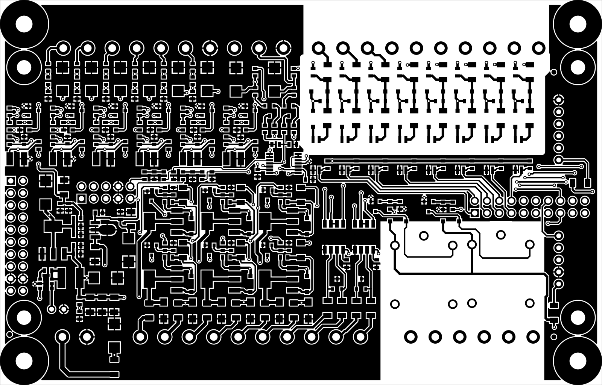

## Inner Copper 1, positivo ('Layer 1' no Altium) (`.g1`)

Camada `In1.Cu` sobre o contorno da placa.

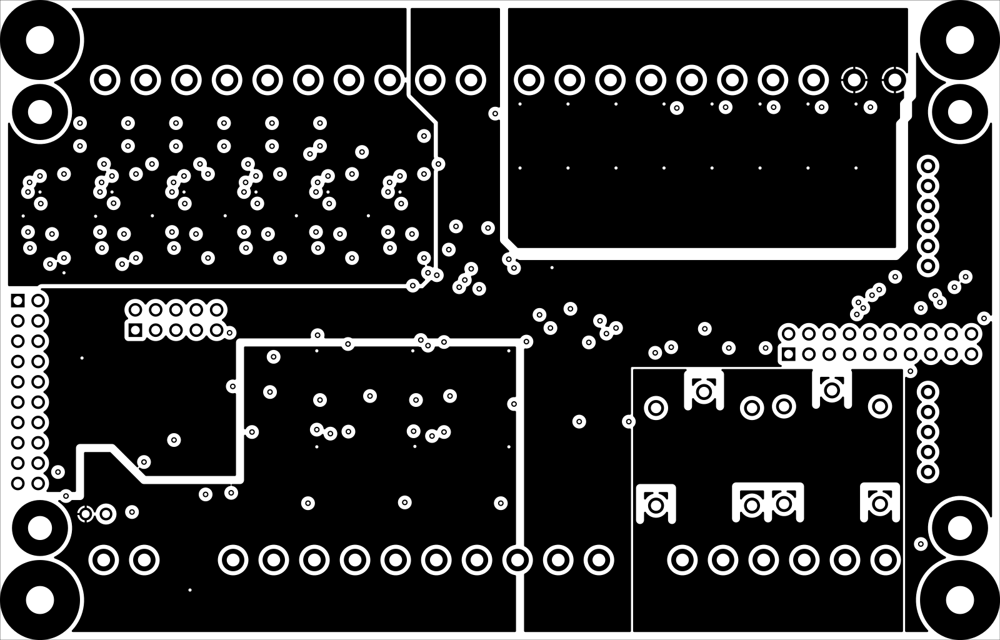

## Inner Copper 2, positivo ('Layer 2' no Altium) (`.g2`)

Camada `In2.Cu` sobre o contorno da placa.

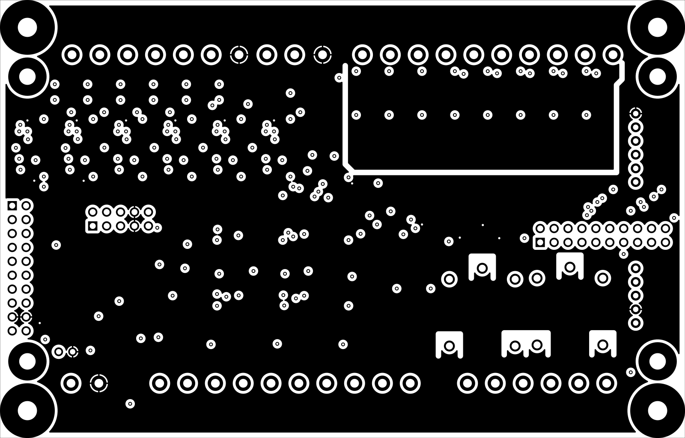

## Bottom Copper (`.gbl`)

Camada `B.Cu` sobre o contorno da placa.

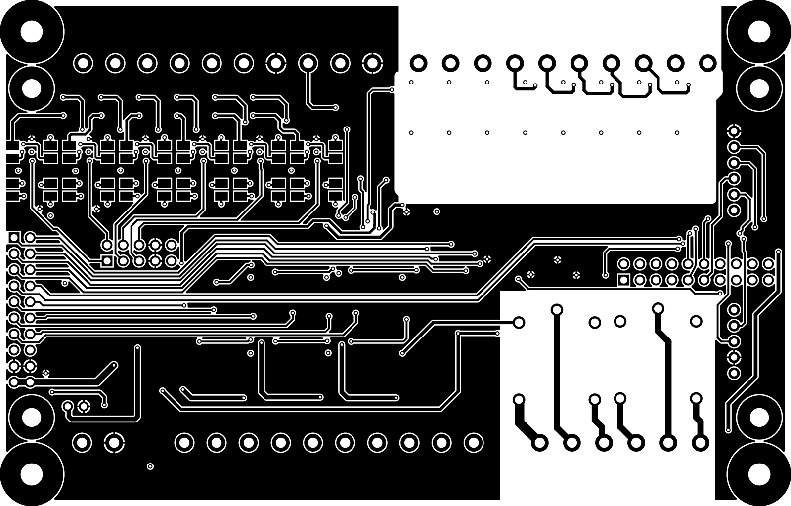

## Top Solder Mask (`.gts`)

Camada `F.Mask` sobre o contorno da placa.

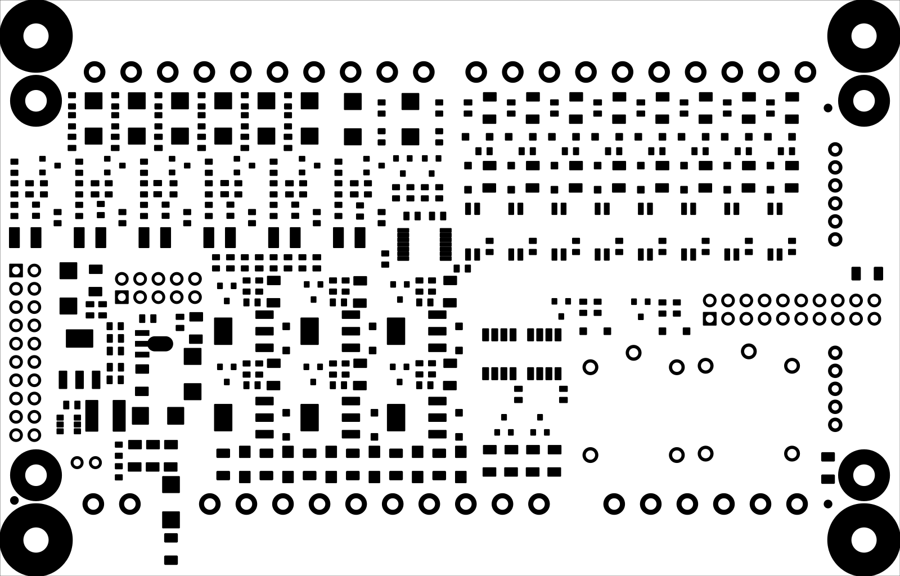

## Bottom Solder Mask (`.gbs`)

Camada `B.Mask` sobre o contorno da placa.

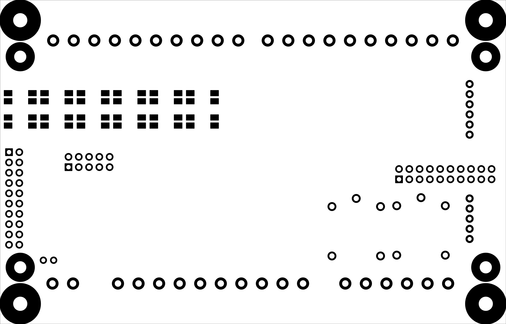

## Top Silkscreen (`.gto`)

Camada `F.Silkscreen` sobre o contorno da placa.

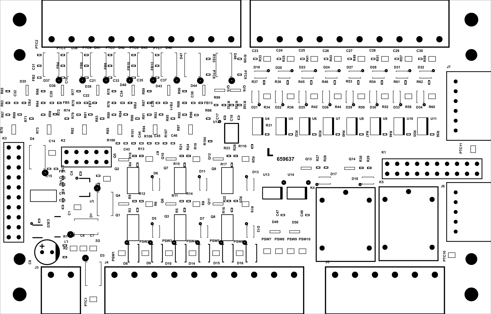

## Bottom Silkscreen (`.gbo`)

Camada `B.Silkscreen` sobre o contorno da placa.

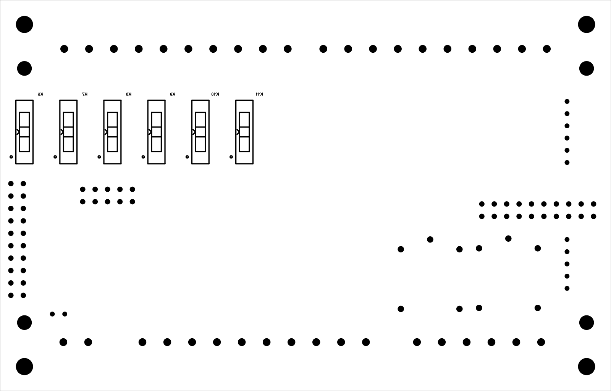

## Top Paste (`.gtp`)

Camada `F.Paste` sobre o contorno da placa.

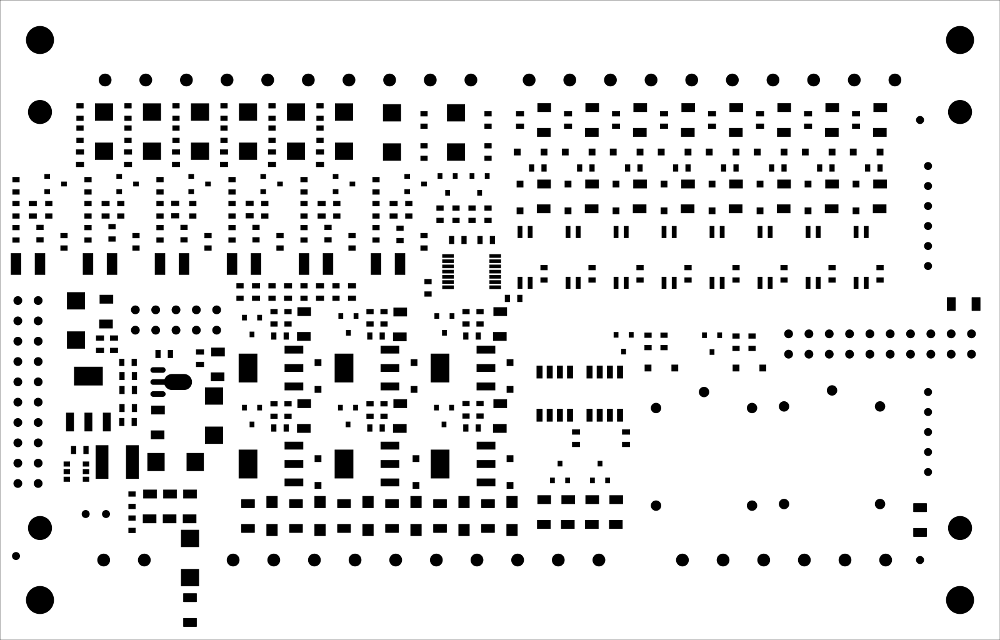

## Bottom Paste (`.gbp`)

Camada `B.Paste` sobre o contorno da placa.

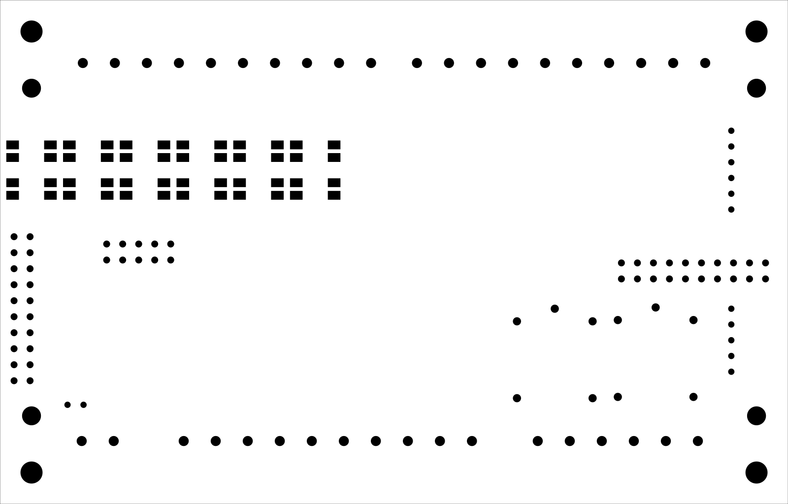

## Board Outline (`.gm1`)

Camada `Edge.Cuts` sobre o contorno da placa.

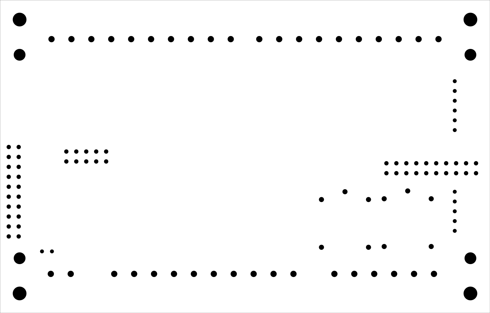
